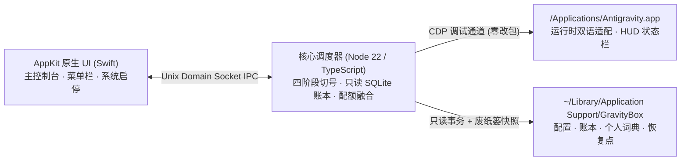

<div align="center">
  <a href="https://github.com/Enzoo404/gravitybox">
    
  </a>

  <h1>GravityBox</h1>

  <p>
    <strong>面向 Apple Silicon macOS 的轻量级 Antigravity 辅助工具箱</strong><br />
    原汁原味 Swift AppKit 界面 · IDE 对话状态栏 · 双周期配额看板 · 只读 SQLite 用量与费用核算 · 运行时双语热适配
  </p>

  <p>
    <a href="https://github.com/Enzoo404/gravitybox/releases/latest"></a>
    <a href="https://github.com/Enzoo404/gravitybox/actions/workflows/ci.yml"></a>
    
    <a href="./LICENSE"></a>
  </p>

  <p>
    <b>简体中文</b> · <a href="./README_EN.md">English</a>
  </p>

  <p>
    <a href="#-为什么选择-gravitybox">核心优势</a> ·
    <a href="#-ide-对话状态栏-telemetry-hud">对话状态栏</a> ·
    <a href="#-核心功能">核心功能</a> ·
    <a href="#-界面预览">界面预览</a> ·
    <a href="#-安装与无损升级">安装与升级</a> ·
    <a href="#-架构与源码构建">架构与构建</a> ·
    <a href="#-安全与隐私边界">安全声明</a>
  </p>
</div>

<br />

<div align="center">
  <picture>
    <source media="(prefers-color-scheme: dark)" srcset="assets/screenshots/hero-dark.png" />
    
  </picture>
  <sub><em>macOS 原生 AppKit 主控制台与常驻菜单栏面板（随系统自动切换浅色 / 深色外观）</em></sub>
</div>

---

## ✨ 为什么选择 GravityBox？

GravityBox 专注于在不修改官方 Antigravity 应用包的前提下，补齐高频多账号协作、配额透明度与精细化能耗分析能力：

| 痛点维度 | 默认使用体验 | GravityBox 工程方案 |
| :--- | :--- | :--- |
| **账号切换与凭据安全** | 需手动退出并反复重登，存在状态残留或切错风险 | **四阶段原子快照事务 + 原位自动回滚**；强制检查官方应用与共享凭据冲突，由用户手动确认切换 |
| **配额口径透明度** | 容易将每周配额混淆为 5 小时滚动重置周期 | **双周期严格分轨**；优先展示真实 5 小时窗口，缺失时明确标注"模型配额"与准确重置时间 |
| **对话实时耗时与开销** | 对单轮速率、首字延迟、缓存省钱和上下文比例无感知 | 内嵌 **Telemetry HUD 状态栏** + **本地只读 SQLite 核算引擎**，按时序计价基准还原估算成本 |
| **界面语言与原包完整性** | 非中文用户依赖静态汉化补丁，易破坏官方应用代码签名 | 基于 **CDP 运行时增量适配**，零修改、零重签 `/Applications/Antigravity.app` |
| **缓存膨胀与清理风险** | 长期使用后状态日志膨胀，手动清理存在误删风险 | 可视化存储瘦身；所有清理操作**默认移入系统废纸篓**并生成时间戳快照，支持一键还原 |

---

## 📊 IDE 对话状态栏 (Telemetry HUD)

在不遮挡输入框、不抢夺编辑器输入焦点的前提下，实时将底层性能与消费指标呈现在每一个 Antigravity 对话输入框下方，鼠标悬浮或点击即可**向上弹出**详细卡片（全面适配分栏多会话与浅/深双色主题）：

<div align="center">
  <picture>
    <source media="(prefers-color-scheme: dark)" srcset="assets/screenshots/hud-dark.png" />
    
  </picture>
</div>

- **会话速率胶囊**：实时统计对话轮次、当轮/累计思考耗时、工具执行耗时、首字延迟（TTFT，自动排除思维链空闲耗时以还原真实吞吐 `tok/s`），并在流式生成或后台子智能体运行期间呈现呼吸态动画。
- **Token 与成本胶囊**：即时核算总 Token、未缓存输入、缓存读取与输出明细，结合当前模型命中率与官方计价区间计算**本次估算费用**及**缓存已节省费用**。
- **上下文窗口胶囊**：依据当前绑定模型的真实上下文容量，动态绘制系统提示词、工具定义与对话消息的三色构成条，高水位时提供清晰预警提醒。

---

## 🧭 核心功能

### 1. 多账号管理与四阶段安全切换
- **智能推荐与人工确认**：根据各账号剩余配额、禁用状态与数据新鲜度综合评估备用候选账号并给出提示，切换动作始终由用户确认执行。
- **零强杀保护与冲突拦截**：严禁后台强制 `kill` 官方进程；切号前自动核验官方应用（以及可能共享凭据的 Insiders 进程）均处于退出状态后方可执行。
- **全自动原位回滚**：备份、同步、验证任一阶段发生异常时立即回滚至切号前快照，保障本地会话、钥匙串索引与登录态不损坏。

### 2. 双周期配额看板与本地费用核算
- **真窗口识别**：同时观测 Gemini 5 小时滚动窗口、每周窗口及 Claude/GPT 组别配额，准确保留"未知 / 禁用 / 已耗尽 / 陈旧"状态语义。
- **后台分批只读扫描**：在独立 Worker 中通过只读 SQLite 事务分批解析本地会话日志，绝不阻塞官方 IDE 响应；提供 **今日 / 近 7 天 / 近 30 天 / 全部** 四档时间窗与逐小时消耗柱状图。
- **开源公开计价基准**：内建模型费率账本与生效区间版本校验，可选在设置页开启"自动更新价格基准"同步最新公开模型费率。

### 3. 非侵入式双语热适配（中 / En）
- **零改包运行**：通过 Chrome DevTools Protocol (`CDP`) 注入隔离运行时，实现菜单、侧栏、弹窗与新版本的动态热更新双语切换，官方应用更新后可平稳跟随。
- **内容绝对隔离**：对话编辑器草稿、历史对话正文、代码块、终端输出、工作区路径与专有品牌名受到 DOM 选择器与词库边界严格保护，绝不篡改。
- **可逆异常降级**：DOM 结构变化或连接断开时自动回退至最后一份有效状态或官方原版英文，不抛出侵入式报错。

### 4. 可逆存储瘦身与系统伴随
- **废纸篓安全删除**：精准识别可释放的冗余缓存、损坏索引与历史状态快照；清理前直观展示拟释放体积，清理时统一移入 macOS **废纸篓** 并创建恢复点。
- **菜单栏常驻效率**：支持开机自启及随官方 Antigravity 自动启停，随时一键唤起「用量 · 配额 · 账号」三页高频面板。

---

## 🖼 界面预览

> 所有界面均采用原生 macOS Swift AppKit 构建；下方预览将自动跟随您的系统/浏览器外观切换浅色与深色模式。

<table>
  <tr>
    <td width="50%" align="center">
      <b>主窗口 · 总览看板</b><br /><br />
      <picture>
        <source media="(prefers-color-scheme: dark)" srcset="assets/screenshots/dark-overview.png" />
        
      </picture>
    </td>
    <td width="50%" align="center">
      <b>主窗口 · 多账号管理</b><br /><br />
      <picture>
        <source media="(prefers-color-scheme: dark)" srcset="assets/screenshots/dark-accounts.png" />
        
      </picture>
    </td>
  </tr>
  <tr>
    <td width="50%" align="center">
      <b>主窗口 · 用量与费用明细</b><br /><br />
      <picture>
        <source media="(prefers-color-scheme: dark)" srcset="assets/screenshots/dark-usage.png" />
        
      </picture>
    </td>
    <td width="50%" align="center">
      <b>主窗口 · 偏好设置</b><br /><br />
      <picture>
        <source media="(prefers-color-scheme: dark)" srcset="assets/screenshots/dark-settings.png" />
        
      </picture>
    </td>
  </tr>
</table>

<details>
<summary>展开更多实机截图：常驻菜单栏三页签、存储瘦身弹窗与关于页</summary>
<br />
<table>
  <tr>
    <td width="33.3%" align="center">
      <b>菜单栏 · 用量</b><br /><br />
      <picture>
        <source media="(prefers-color-scheme: dark)" srcset="assets/screenshots/dark-menubar.png" />
        
      </picture>
    </td>
    <td width="33.3%" align="center">
      <b>菜单栏 · 配额</b><br /><br />
      <picture>
        <source media="(prefers-color-scheme: dark)" srcset="assets/screenshots/dark-menubar-quota.png" />
        
      </picture>
    </td>
    <td width="33.3%" align="center">
      <b>菜单栏 · 账号</b><br /><br />
      <picture>
        <source media="(prefers-color-scheme: dark)" srcset="assets/screenshots/dark-menubar-accounts.png" />
        
      </picture>
    </td>
  </tr>
  <tr>
    <td colspan="2" align="center">
      <b>安全存储瘦身弹窗</b><br /><br />
      <picture>
        <source media="(prefers-color-scheme: dark)" srcset="assets/screenshots/dark-maintenance.png" />
        
      </picture>
    </td>
    <td align="center">
      <b>关于与更新页</b><br /><br />
      <picture>
        <source media="(prefers-color-scheme: dark)" srcset="assets/screenshots/dark-about.png" />
        
      </picture>
    </td>
  </tr>
</table>
</details>

---

## 🚀 安装与无损升级

### 环境要求
- **操作系统**：macOS 14 (Sonoma) 或 macOS 15+ (Sequoia)
- **芯片架构**：Apple Silicon (`arm64`)
- **目标应用**：官方正式版 `/Applications/Antigravity.app`（*不支持也不干扰 Insiders 通道*）
- **运行依赖**：零额外依赖 —— 安装包已内嵌自包含 Node 22 运行环境与原生 Swift 宿主程序

### 首次安装（推荐）

1. 前往 [GitHub Releases](https://github.com/Enzoo404/gravitybox/releases/latest) 下载最新的 `GravityBox-<version>-arm64.dmg` 与同名 `.sha256` 校验文件。
2. *(推荐)* 校验安装包完整性：
   ```bash
   shasum -a 256 -c GravityBox-<version>-arm64.dmg.sha256
   ```
3. 双击挂载 DMG，将 **GravityBox.app** 拖入 **应用程序 (`Applications`)** 文件夹。
4. 由于开源发布包暂未经过 Apple Developer 付费公证，首次启动前请任选以下一种方式放行：
   - **终端一键放行（推荐）**：
     ```bash
     xattr -cr /Applications/GravityBox.app
     ```
   - **图形界面放行**：首次双击若遇系统拦截提示，前往 **系统设置 → 隐私与安全性**，点击 **“仍要打开”** 即可。

### 从旧版本升级
- **直接覆盖无损升级**：关闭 GravityBox，将新版拖入 `/Applications` 替换即可。所有账号配置、个人词典覆盖、用量历史账本与恢复快照（存放于 `~/Library/Application Support/GravityBox`）均**完整保留**。
- **通道自动迁移说明**：若 `v1.0.5` 及更早版本配置中曾设置 `applicationChannel=insiders`，新版首次启动时会自动先做备份并迁移为官方正式版模式，其余个人偏好不受影响。
- **应用内更新检查**：默认保持完全静默关闭；可在主窗口 **关于** 页手动点击“检查更新”或按需开启自动检查 GitHub Releases。

<details>
<summary>进阶可选：为自构建版本配置 Google OAuth 官方配额查询凭据</summary>

仅使用本地只读配额探测、HUD 状态栏、SQLite 用量分析与运行时汉化功能时，**无需配置任何 OAuth 凭据**。如果您从源码构建或需要自定义 OAuth 客户端 ID 配合实时配额 API 使用，可在启动环境或自定义构建变量中提供：

```bash
export GRAVITYBOX_GOOGLE_CLIENT_ID="your-client-id.apps.googleusercontent.com"
export GRAVITYBOX_GOOGLE_CLIENT_SECRET="your-client-secret"
```

</details>

---

## 🔒 安全与隐私边界

| 安全基线 | 工程实现说明 |
| :--- | :--- |
| **零外部遥测** | 不嵌入任何统计 SDK、崩溃上报或未经用户明示请求的后台外连；自动更新默认关闭 |
| **官方原包零篡改** | 绝不解包、覆盖写入或重签名 `/Applications/Antigravity.app` |
| **用户数据纯本地隔离** | 账号元数据、钥匙串索引、历史用量与快照统一存放于 `~/Library/Application Support/GravityBox` |
| **严格敏感字段遮蔽** | HUD 与汉化管线严格锁定输入草稿、对话正文、代码块、终端输出及项目名称 |

---

## 🛠 架构与源码构建



### 从源码编译与全量测试

> 源码开发要求本机已安装 Xcode Command Line Tools 及 Node.js `>=22.15.0 <23`。

```bash
git clone https://github.com/Enzoo404/gravitybox.git
cd gravitybox
npm ci

# 运行日常构建、定价校验与核心单测/集成测试
npm test

# 按需运行 Swift 原生界面编译与排版验证
npm run check:swift

# 运行完整发版门禁（TS + 单测 + 无头浏览器回归 + Swift 编译 + 词典门禁）
npm run verify

# 打包本地 Apple Silicon .app 与可分发 .dmg
npm run package:mac
```

<details>
<summary>查看仓库核心目录结构</summary>

```text
gravitybox/
├── native/          # Swift 6 / AppKit 原生主控制台、菜单栏面板与内置更新器
├── src/             # TypeScript 核心引擎（IPC、四阶段切号、配额融合、SQLite 用量账本、HUD 编排）
├── runtime/         # CDP 注入运行时代码（增量翻译引擎、DOM 边界保护与对话状态栏 UI）
├── dict/            # 多版本 UI 双语词典、冻结映射与公共术语规则
├── assets/          # 应用图标、高清实机截图、公开计价基准 (pricing-feed.json) 与模型列表
├── test/            # 单元测试、并发/边界集成测试、无头 Chromium 回归与 Swift UI 自检
└── tools/           # 门禁校验脚本、截图排版脚本、macOS 应用与 DMG 打包脚本
```

</details>

---

## ❓ 常见问题

<details>
<summary><b>为什么必须关闭 Antigravity 后才能切号？</b></summary>

直接覆盖运行中桌面应用的数据目录与凭据缓存极易导致 SQLite 锁死或认证态错乱。GravityBox 采用先检查后切换的四阶段原子事务，坚决不在后台强行终止进程，确保工作区零损失、状态 100% 一致。

</details>

<details>
<summary><b>启用汉化与 HUD 会修改我的聊天内容、代码或工作区名称吗？</b></summary>

不会。引擎通过标准 DOM 属性与结构白名单严格隔离输入区、对话记录、代码块、终端输出及工作区标识；所有计算与适配均仅作用于界面展现层，不修改磁盘中的任何工程或聊天文件。

</details>

<details>
<summary><b>如何彻底还原或清理 GravityBox？</b></summary>

若需恢复某个界面或释放缓存，优先在「设置 → 管理存储」中利用快照还原；如需完全卸载，退出 GravityBox 后将其移至废纸篓，再按需清理 `~/Library/Application Support/GravityBox` 即可。

</details>

---

## 🤝 参与贡献与开源协议

- 欢迎阅读 [贡献指南](./CONTRIBUTING.md)、[行为准则](./CODE_OF_CONDUCT.md) 与 [安全政策](./SECURITY.md) 后提交 [Issue](https://github.com/Enzoo404/gravitybox/issues) 或 Pull Request。
- 版本变更历史与详细发布日志请查看 [CHANGELOG](./CHANGELOG.md) 或 [GitHub Releases](https://github.com/Enzoo404/gravitybox/releases)。

<div align="center">
  <a href="https://star-history.com/#Enzoo404/gravitybox&Date">
    
  </a>
</div>

<p align="center">
  <sub>本项目基于 <a href="./LICENSE">MIT License</a> 开源 · 第三方许可见 <a href="./THIRD_PARTY_NOTICES.md">THIRD_PARTY_NOTICES</a> · 与 Google / Antigravity 官方无任何从属或背书关系。</sub>
</p>
