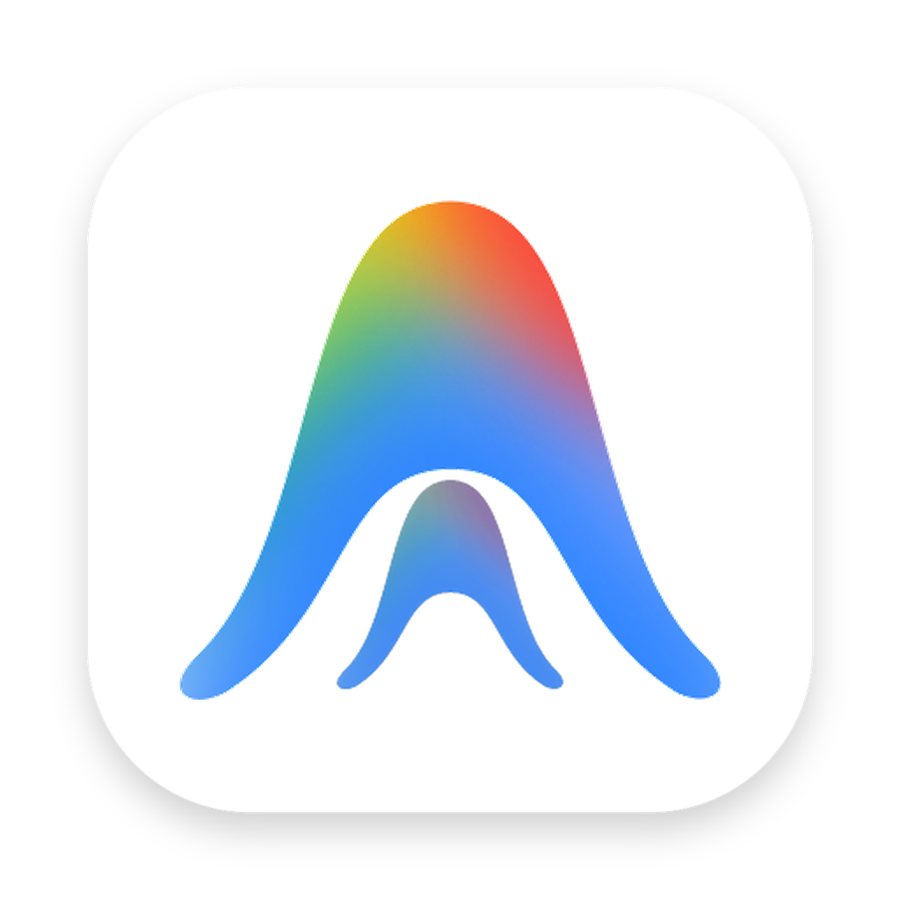
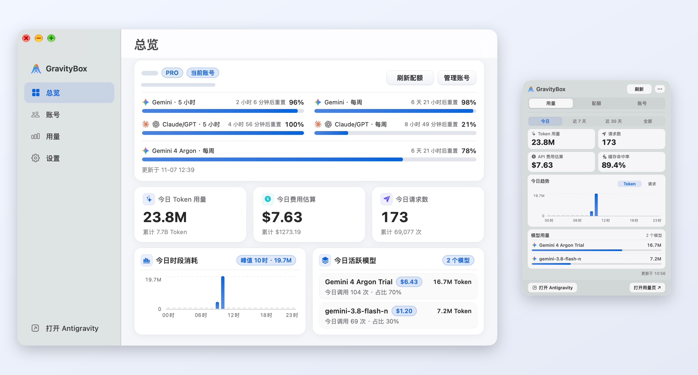
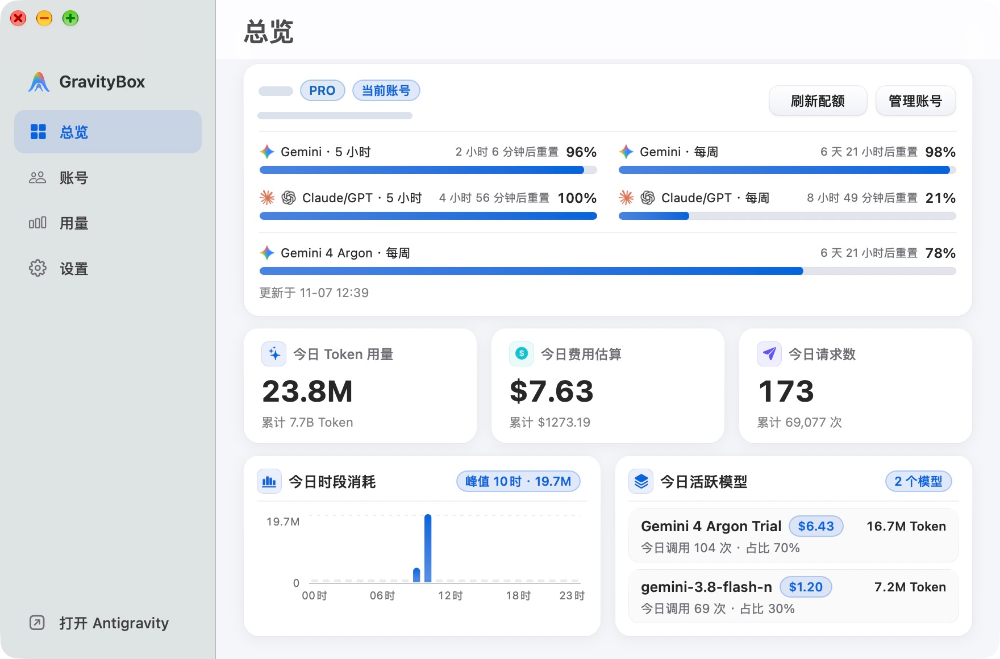
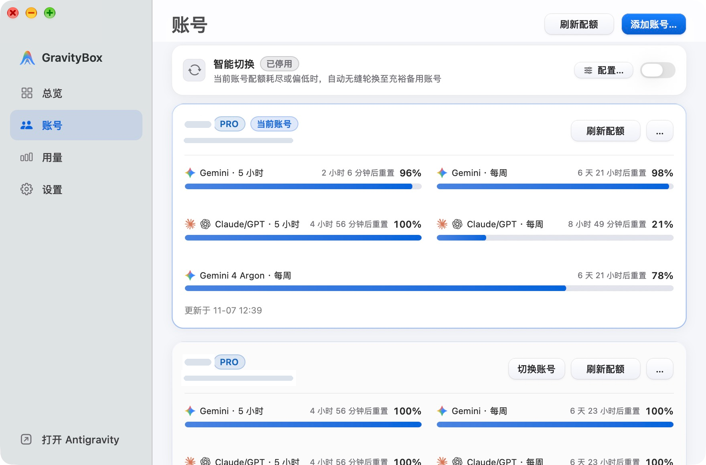
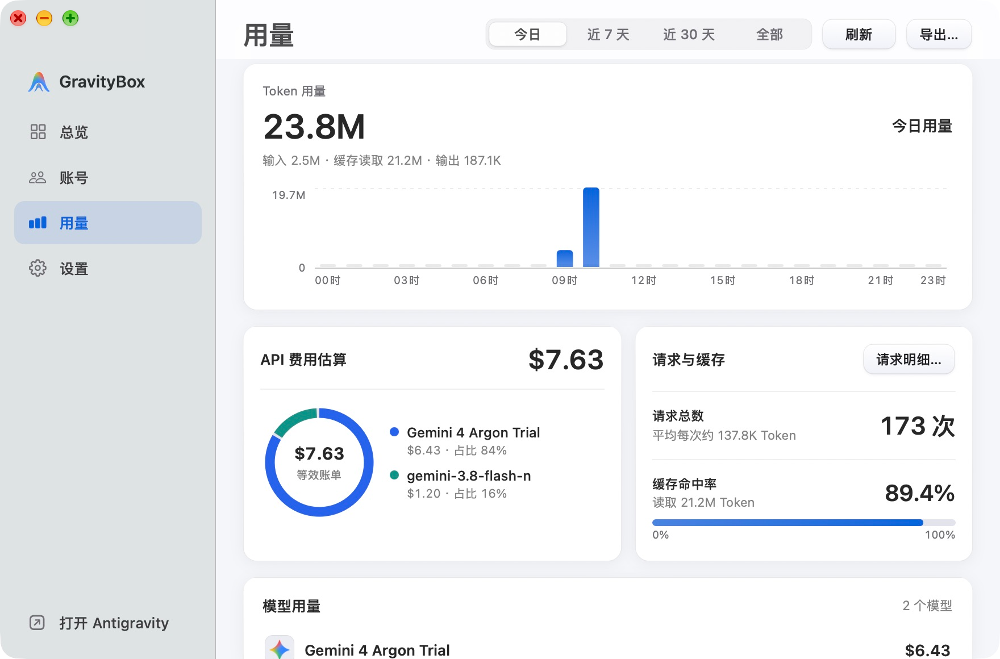
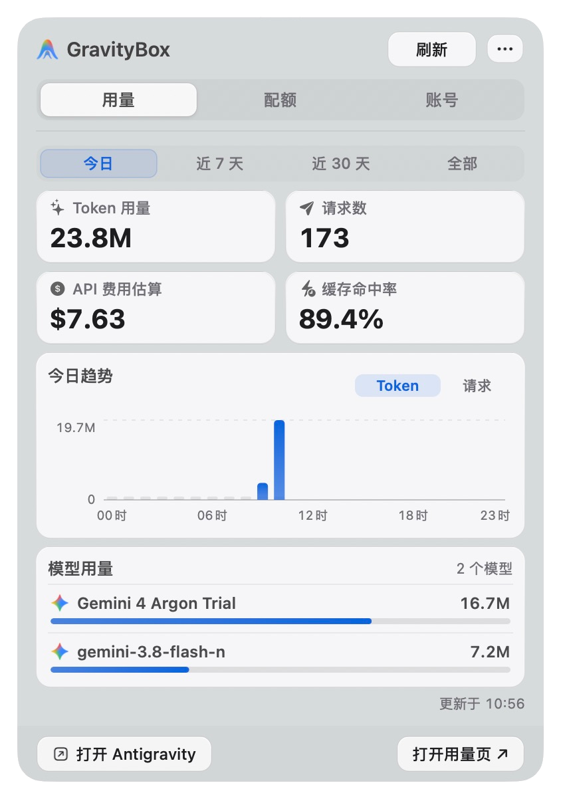

<div align="center">
  

  <h1>GravityBox</h1>

  <p>
    <strong>Google Antigravity 的 macOS 原生伴侣应用</strong><br>
    <sub>界面汉化 · 配额监控 · 多账号切换 · Token 用量与费用估算 · 缓存维护</sub>
  </p>

  <p>
    <a href="https://github.com/Enzoo404/gravitybox/releases/latest"></a>
    <a href="https://github.com/Enzoo404/gravitybox/actions/workflows/ci.yml"></a>
    <a href="./LICENSE"></a>
    
    
  </p>

  <p>
    <a href="#功能速览">功能速览</a> ·
    <a href="#安装与快速上手">安装与上手</a> ·
    <a href="#功能详解">功能详解</a> ·
    <a href="#常见问题">常见问题</a> ·
    <a href="#隐私安全与架构">安全与架构</a> ·
    <a href="#从源码构建">源码构建</a>
  </p>
</div>

<p align="center">
  <a href="assets/screenshots/hero.png"></a>
</p>

<p align="center">
  <strong>一屏掌握配额与用量，编码时也能随手查看。</strong><br>
  <a href="https://github.com/Enzoo404/gravitybox/releases/latest">下载 macOS 版</a> ·
  <a href="#安装与快速上手">快速上手</a> ·
  <a href="#从源码构建">从源码构建</a>
</p>

<details>
<summary><strong>查看 4 张完整实机截图：总览 · 账号 · 用量 · 菜单栏</strong></summary>

<p><strong>总览</strong> · 剩余配额、重置倒计时与今日模型消耗。</p>
<p align="center"><a href="assets/screenshots/overview.png"></a></p>

<p><strong>账号</strong> · 对比当前与备用账号的配额，集中管理多个账号。</p>
<p align="center"><a href="assets/screenshots/accounts.png"></a></p>

<p><strong>用量</strong> · Token 趋势、模型费用占比与缓存命中率。</p>
<p align="center"><a href="assets/screenshots/usage.png"></a></p>

<p><strong>菜单栏快捷面板</strong> · 不离开当前工作窗口，随手查看用量与趋势。</p>
<p align="center"><a href="assets/screenshots/menubar.png"></a></p>

</details>

<p align="center"><sub>GravityBox v1.0.0 · macOS 实机截图，身份信息已脱敏。首图由总览与菜单栏截图排版合成；费用为 API 等效估算。<a href="assets/screenshots/README.md">截图说明</a></sub></p>

---

## 功能速览

GravityBox 是为 [Google Antigravity](https://antigravity.google) 打造的 macOS 原生辅助工具，用来解决日常高频使用中的几项核心痛点：

| 常见场景 | GravityBox 提供的能力 |
| :--- | :--- |
| **界面汉化** | 运行时动态替换界面文案，**不修改 `app.asar`、不破坏应用签名**，官方更新后无需重打补丁；自动跳过代码、终端与对话内容，支持随时切回英文。 |
| **配额监控** | 直观展示 **Gemini（5 小时 + 每周）**、**Claude / GPT（5 小时 + 每周）** 与 **Gemini 4 Argon（每周）** 的剩余额度百分比与重置倒计时，低额度自动变色预警。 |
| **多账号切换** | 支持一键保存本机已登录账号或通过 Google OAuth 添加备用账号；切换时自动完成「退出应用 → 写入凭据 → 重启应用」，并提供 7 天恢复点回滚与低额度换号推荐。 |
| **用量与费用** | 按今日 / 7 天 / 30 天 / 全部统计输入、输出、缓存 Token 与请求数，内置模型价格表估算等效 API 费用，支持检索和导出单次请求明细。 |
| **缓存维护** | 分类扫描运行缓存与会话状态，**严格锁定保护账号凭据与对话数据库（`state.vscdb`）**；清理文件统一移入系统废纸篓，支持一键原位恢复。 |

### 双界面协同设计

应用采用 Swift / AppKit 原生构建，自动适配 macOS 浅色与深色模式，提供两套交互入口：

- **菜单栏快捷面板**：常驻屏幕右上角状态栏，包含 **「用量」「配额」「账号」** 三个标签页与汉化开关。编码时无需切换窗口，即可速览剩余额度、展开对比备用账号或一键切号。
- **主窗口工作台**：左侧为毛玻璃导航栏（带底部「打开 Antigravity」快捷启动按钮），右侧分为 **「总览 (`⌘1`)」「账号 (`⌘2`)」「用量 (`⌘3`)」「设置 (`⌘4`)」** 四个主页面，适合查看完整图表、管理多账号与执行缓存清理。

---

## 安装与快速上手

**系统要求**：macOS 14.0 (Sonoma) 及以上，Apple Silicon (`arm64`，M 系列芯片)；已安装 Google Antigravity（支持正式版与 Insiders 预览版）。

### 1. 下载安装
1. 前往 [**Releases**](https://github.com/Enzoo404/gravitybox/releases/latest) 下载最新的 `GravityBox-<version>-arm64.dmg`（安装包已内置独立运行环境，无需配置 Node.js）；
2. 双击挂载 DMG，将 `GravityBox.app` 拖入 `Applications`（应用程序）文件夹；
3. 由于应用采用本地 Ad-hoc 签名、未经过 Apple Developer 公证，首次打开若提示“无法验证开发者”或“已损坏”，请在终端执行以下命令放行：

   ```bash
   sudo xattr -rd com.apple.quarantine /Applications/GravityBox.app
   ```

### 2. 快速上手
1. **开启汉化**：启动 GravityBox，在主窗口「设置」页或右上角菜单栏面板的 `…` 菜单中打开 **「界面汉化」**，正在运行的 Antigravity 即刻切换为中文；
2. **纳管本机账号**：进入「账号」页，点击右上角 **「添加账号… -> 保存当前账号」**，即可直接将当前登录的 Antigravity 账号纳入管理并查看实时配额；
3. **日常联动设置**：在「设置」中可按需开启 **「跟随 Antigravity 启停」**（打开 Antigravity 时自动启动 GravityBox，关闭时自动一并退出），或点击 **「管理缓存…」** 释放磁盘空间。

<details>
<summary><strong>⚙️ 可选配置：使用浏览器 Google OAuth 添加账号与后台云端配额刷新（点击展开）</strong></summary>

<br>

> [!NOTE]
> 直接保存本机已登录账号、查看本机实时配额、使用界面汉化、统计本地 Token 用量与清理缓存**均无需此配置**。

如果你希望通过 **「Google 授权登录…」** 在浏览器中添加更多备用账号，或让未激活的备用账号在后台通过 Google 云端接口定时刷新配额，请配置你自己的 Google OAuth 客户端凭据。

复制仓库中的 [`.env.example`](./.env.example) 为 `.env`，放置在 `~/Library/Application Support/GravityBox/.env`（从源码运行时也可放在项目根目录）：

```bash
# Google OAuth 客户端凭据（用于浏览器授权添加账号及云端配额刷新）
GRAVITYBOX_GOOGLE_CLIENT_ID=your_client_id.apps.googleusercontent.com
GRAVITYBOX_GOOGLE_CLIENT_SECRET=your_client_secret

# 可选：自定义远程模型价格表 URL（默认指向本仓库 main 分支的 assets/pricing-feed.json）
# GRAVITYBOX_PRICING_FEED_URL=https://raw.githubusercontent.com/Enzoo404/gravitybox/main/assets/pricing-feed.json
```

</details>

---

## 功能详解

### 1. 非侵入式界面汉化
- **不改写官方应用包**：通过本机调试接口在运行时替换菜单、按钮、设置项与状态提示文案，不解包、不修改 `app.asar`、不重签名。既不触发 macOS Gatekeeper 签名拦截，Antigravity 官方升级后也无需重新打补丁；
- **代码与内容保护**：自动识别并跳过代码编辑器（`.monaco-editor`）、终端（`.xterm`）、代码块、对话正文、未发送草稿、项目名称以及 70 余项技术与品牌专有名词，只翻译界面控件；
- **即时生效与还原**：随时开关「界面汉化」，关闭后立即恢复为原版英文界面，无需重启 Antigravity；
- **分层外置词典**：词典（`dict/`）按功能模块与版本增量维护，已对 Antigravity `2.23.0`～`2.28.0` 完成覆盖率门禁校验。

### 2. 多维度配额监控
- **按订阅等级精准展示**：
  - **PRO / ULTRA 账号**：独立展示 **Gemini（5 小时 + 每周）**、**Claude / GPT（5 小时 + 每周）** 与 **Gemini 4 Argon（每周）** 共 5 条配额进度条及重置倒计时；
  - **FREE 账号**：自动适配展示各模型系列的模型配额与每周配额；
- **严守真实数据**：5 小时滚动窗口与每周额度严格区分，未获取到真实数据时明确标注状态，不做虚假估算；剩余额度 `≤20%` 时进度条变为橙色预警，`≤10%` 或耗尽时变为红色警示；
- **双源采集与定时同步**：当前激活账号优先从本机运行的 Antigravity 服务实时读取配额；已保存的备用账号支持手动或后台定时（每 5 / 10 / 15 / 30 / 60 分钟）通过云端接口刷新。

### 3. 多账号管理与智能切换
- **灵活入库与备份**：支持「保存当前账号」零配置一键入库，或通过「Google 授权登录…」在浏览器中完成 OAuth 授权添加新账号；支持导出脱敏摘要或含凭据备份；
- **自动停启的安全切号**：发起切换时，先检查 Antigravity 运行状态及是否有正在执行的 Agent 任务（若有活跃任务会提示中断风险）。确认后自动执行 **退出 Antigravity → 在本地数据库与 macOS 钥匙串中写入新账号凭据 → 重新启动 Antigravity**；
- **7 天恢复点回滚**：每次切换自动生成快照恢复点，遇到异常可在账号页顶部横幅中一键「撤销并恢复原账号」；
- **智能切换推荐**：开启后可设定推荐排序方式（「配额充裕优先」或「按顺序轮询」，均优先推荐 ULTRA / PRO 账号）、监测模型范围、触发阈值（默认 `10%`）与候选准入下限（默认 `30%`），在额度不足时自动标出最佳备用账号。

### 4. Token 用量统计与 API 费用估算
- **多维可视化看板**：支持按 **「今日」「近 7 天」「近 30 天」「全部」** 统计请求总数、输入 Token、缓存读取 Token、缓存写入 Token、输出 Token 及缓存命中率，提供时段/按日趋势柱状图与模型费用占比环图；
- **逐条请求明细与导出**：在「用量」页点击「请求明细…」可按时间倒序查看每次调用的模型、时间与四类 Token 消耗，支持按模型名搜索、翻页与导出 JSON 报告；
- **时间感知计费模型**：内置主流 Gemini、Claude、GPT 模型价格表（[`assets/model-catalog.json`](./assets/model-catalog.json)），支持限时优惠价与标准正式价的生效时间段自动匹配，历史调用按发生时的有效单价计算。

### 5. 缓存维护与系统联动
- **三分类扫描与核心保护**：在「设置 -> 存储与维护 -> 管理缓存…」中，将本地文件严格划分为三类：
  - **运行加速缓存（推荐清理，默认勾选）**：网络与静态资源缓存、V8 字节码编译缓存、Metal / WebGL 图形与着色器缓存、工作区编译缓存与崩溃日志；
  - **会话状态与应用授权（谨慎清理，默认不勾选）**：Cookies、Local Storage、Service Worker 等，勾选前会提示可能导致部分扩展需重新登录；
  - **已保护核心数据（只读展示，绝不触碰）**：`state.vscdb` 核心账号凭据与 Agent 历史对话数据库，始终受严格保护；
- **废纸篓快照与原位恢复**：清理时不执行物理硬删除，而是将选中缓存移入系统废纸篓并记录恢复点，随时可点击「原位恢复」一键还原；
- **内置校验的在线更新**：支持检查 GitHub Release 新版本与后台预下载，执行升级时自动完成 **SHA-256 哈希校验、DMG 镜像校验与代码签名校验**。

---

## 常见问题

<details>
<summary><strong>Q1: 开启界面汉化会修改 Antigravity 安装包或影响官方更新吗？</strong></summary>

<br>

不会。GravityBox 在运行时通过本地回环调试接口替换界面文本，不解包、不修改 `app.asar`、也不重签名官方应用，因此不会破坏 macOS 签名校验，Antigravity 官方升级后也无需重新打补丁。
</details>

<details>
<summary><strong>Q2: 用量页显示的 API 费用代表我的实际账单吗？</strong></summary>

<br>

不是实际账单。用量页中的「API 费用估算」是基于本地记录的 Token 消耗量，对照 Google / Anthropic / OpenAI 公开的按量计费 API 单价（含缓存读写价格与限时优惠区间）折算的**等效参考值**，用于帮助你衡量日常用量规模，不代表订阅制下的实际扣费。
</details>

<details>
<summary><strong>Q3: 支持 Intel 芯片的 Mac 或其他操作系统吗？</strong></summary>

<br>

目前仅构建并支持 Apple Silicon (`arm64`) 架构、运行 macOS 14.0 及以上系统的 Mac。
</details>

---

## 隐私安全与架构

- **零遥测与零埋点**：不包含任何第三方统计、崩溃上报或行为追踪代码；
- **凭据系统级隔离**：所有账号的 OAuth 令牌与敏感凭据仅存放在本机 **macOS 钥匙串（Keychain）** 中，本地配置文件（`accounts.json`）与历史日志仅保留脱敏索引；
- **只读数据库快照**：统计 Token 用量时，在独立 Worker 线程中以只读模式读取本地会话数据库，不写入、不加锁，不阻塞 Antigravity 的正常读写；
- **外联边界透明**：应用仅在以下明确场景发起网络请求：
  1. 连接 Google 官方接口完成账号 OAuth 授权与云端配额查询；
  2. 连接 GitHub Releases / Raw 接口检查版本更新与同步公开模型价格表。

<details>
<summary><strong>📐 查看系统架构图与仓库目录结构（点击展开）</strong></summary>

<br>

```text
┌──────────────────────────────────────────────────────────────────────┐
│                      Native macOS App (Swift / AppKit)               │
│   Main Window (总览 / 账号 / 用量 / 设置)  ·  Menu Bar Panel (三标签)  │
└───────────────────────────────────┬──────────────────────────────────┘
                                    │ Unix Domain Socket (0600, JSON-RPC)
┌───────────────────────────────────▼──────────────────────────────────┐
│                    Core Backend (TypeScript / Node 22)               │
│   Localization (CDP) · Accounts & AutoSwitch · Quota · Usage · Cache │
└──────────┬────────────────────────┬────────────────────────┬─────────┘
           │ Local Loopback CDP     │ Read-Only / Atomic     │ Security Framework
┌──────────▼──────────┐  ┌──────────▼──────────┐  ┌──────────▼──────────┐
│ Google Antigravity  │  │  Local SQLite DBs   │  │   macOS Keychain    │
│ (Isolated World JS) │  │ & Displaced Trash   │  │  (OAuth Credentials)│
└─────────────────────┘  └─────────────────────┘  └─────────────────────┘
```

```text
gravitybox/
├── native/              # Swift / AppKit 原生前端源码（主窗口、菜单栏面板、自更新与系统联动）
├── src/                 # TypeScript 核心后端（汉化控制器、账号切号事务、配额熔合、SQLite 用量分析）
├── runtime/             # 注入 Isolated World 的 DOM 观察与文案替换引擎
├── dict/                # 按功能与版本分层的外置汉化词典
├── ui-strings/          # 基于官方版本指纹（SHA-256）提取的界面文案快照
├── assets/              # 应用图标、内置模型价格表（model-catalog.json）与远程价格源
├── tools/               # 构建、环境诊断（doctor）、词典覆盖率门禁与 DMG 打包脚本
└── test/                # 单元与集成测试、Swift 原生编译测试及无头浏览器回归测试套件
```

</details>

---

## 从源码构建

如需从源码自行编译、调试或打包 DMG，需准备 **macOS 14+**、**Node.js `>=22.15.0 <23`** 以及 **Xcode Command Line Tools**（提供 `swiftc`）。

```bash
# 1. 克隆仓库并检查本地编译环境
git clone https://github.com/Enzoo404/gravitybox.git
cd gravitybox
npm ci
npm run doctor

# 2. 编译 TypeScript 后端并运行单元测试
npm run build
npm test

# 3. 运行完整发布门禁（含 TS 编译、单元测试、浏览器回归、Swift 编译与免 vendor 词典门禁）
node tools/verify.mjs --no-vendor

# 4. 编译原生应用并打包生成 DMG 安装镜像
npm run package:mac
```

---

## 参与贡献

欢迎提交 [Issue](https://github.com/Enzoo404/gravitybox/issues) 反馈问题或发起 Pull Request 参与改进，也欢迎补充和修正 `dict/` 下的汉化词条。

- 提交代码前请先阅读 [CONTRIBUTING.md](./CONTRIBUTING.md) 与 [CODE_OF_CONDUCT.md](./CODE_OF_CONDUCT.md)，版本变更记录详见 [CHANGELOG.md](./CHANGELOG.md)；
- 如发现安全或隐私相关隐患，请勿公开提交 Issue，请按 [SECURITY.md](./SECURITY.md) 中的说明私下联系。

---

## 声明与许可证

GravityBox 是独立的第三方开源项目，与 Google LLC、Anthropic PBC、OpenAI Inc.、Apple Inc. 无任何隶属、合作或背书关系。文中提及的产品名称与商标均归各自权利人所有，详见 [THIRD_PARTY_NOTICES.md](./THIRD_PARTY_NOTICES.md)。使用本项目前，请自行确认符合 Google Antigravity 及相关服务的使用条款，使用风险由使用者自行承担。

[MIT](./LICENSE) © 2026 [Enzoo404](https://github.com/Enzoo404)
