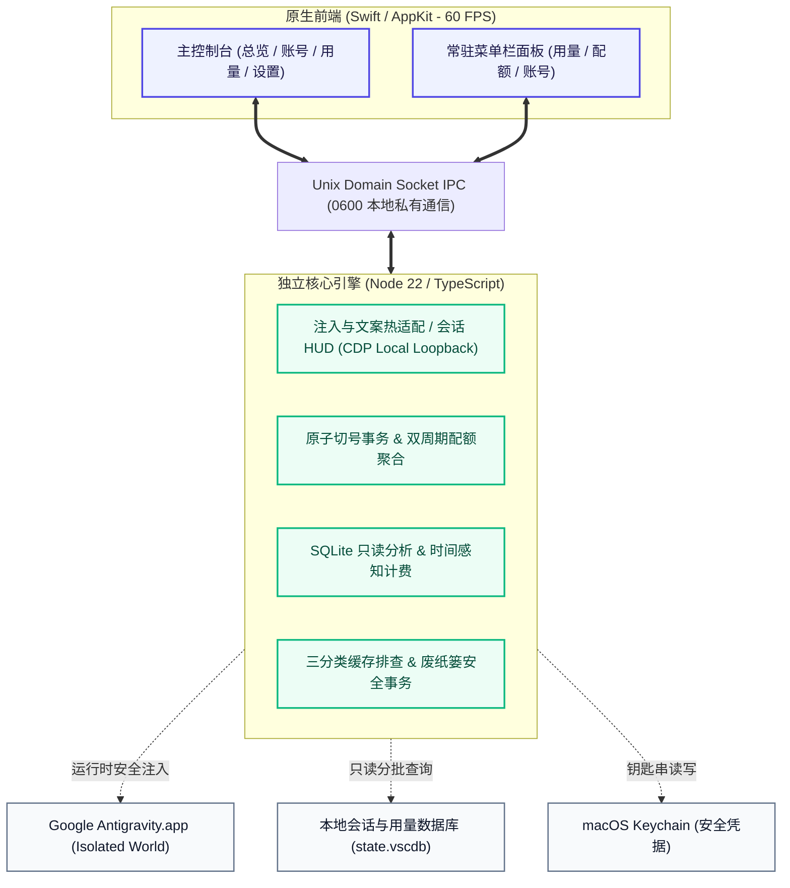

<div align="center">
  <a href="https://github.com/Enzoo404/gravitybox">
    
  </a>

  <h1>GravityBox</h1>

  <p>
    <strong>面向 Google Antigravity 的 macOS 原生生产力套件</strong><br>
    <sub>免解包界面汉化 · 实时会话遥测 HUD · 双周期配额雷达 · 多账号原子切换 · Token 与时序计费 · 安全缓存维护</sub>
  </p>

  <p>
    <a href="README_EN.md">English</a> · <strong>简体中文</strong>
  </p>

  <p>
    <a href="https://github.com/Enzoo404/gravitybox/releases/latest"></a>
    <a href="https://github.com/Enzoo404/gravitybox/actions/workflows/ci.yml"></a>
    <a href="https://github.com/Enzoo404/gravitybox/releases"></a>
    <a href="./LICENSE"></a>
    
    
    
    <a href="https://github.com/Enzoo404/gravitybox/stargazers"></a>
  </p>

  <p>
    <a href="https://github.com/Enzoo404/gravitybox/releases/latest"><b>📥 下载 macOS 版 (DMG)</b></a> ·
    <a href="#-快速上手"><b>⚡ 快速上手</b></a> ·
    <a href="#-为什么选择-gravitybox"><b>💡 为什么选择我们</b></a> ·
    <a href="#-核心特性"><b>✨ 核心特性</b></a> ·
    <a href="#-系统架构与工作原理"><b>📐 系统架构</b></a> ·
    <a href="#-安全与隐私"><b>🛡️ 安全与隐私</b></a>
  </p>
</div>

<p align="center">
  <picture>
    <source media="(prefers-color-scheme: dark)" srcset="assets/screenshots/hero-dark.png">
    <source media="(prefers-color-scheme: light)" srcset="assets/screenshots/hero.png">
    
  </picture>
</p>

<p align="center">
  <strong>专为 macOS 打造的高效伴侣：一屏掌控配额与消耗，会话性能与用量明细随手洞察。</strong>
</p>

---

## 💡 为什么选择 GravityBox？

| 核心考量 | 原生 Google Antigravity | 传统社区脚本 / 侵入补丁 | **GravityBox 原生方案** |
| :--- | :--- | :--- | :--- |
| **界面语言** | 仅官方英文，中文用户认知负载高 | 解包修改 `app.asar`，破坏 macOS 签名，升级频繁失效 | **零侵入内存级热适配**，不触碰二进制，官方升级无感兼容，随时切回原版 |
| **会话性能监控** | 仅转圈等待，无法感知真实速度与吞吐 | 无相关支持 | **输入框内嵌原生 HUD**，实时呈现耗时、TTFT 首字延迟、真实 TPS 及上下文水位 |
| **配额感知** | 仅下拉菜单中简单百分比，滚动周期不透明 | 抓包或模糊估算，混淆 5 小时与每周周期 | **双周期智能熔合雷达**，精准拆解 5h 与每周，额度耗尽前梯级变色预警 |
| **多账号协同** | 退出重登手续繁琐，易产生登录冲突与掉登 | 暴力替换 Cookies，易引发凭据冲突与环境损坏 | **四阶段原子事务切换**，自动快照，支持 7 天内一键秒级原位回滚 |
| **Token 用量与成本** | 无统计面板，缺乏长期消费趋势洞察 | 无统计或仅做本地简单次数累加 | **只读 SQLite 异步审计**，时间感知精准匹配模型历史单价与缓存命中率 |
| **系统侵入与安全** | — | 脚本权限未知，可能篡改系统配置 | **100% 纯本地运行**，零外部埋点，数据落地 `0600` 本地文件，原生废纸篓软删除 |

---

## 📸 实机界面全景 (Retina 高清画廊)

<p align="center">
  
  
</p>
<p align="center">
  
  
</p>
<p align="center">
  
  
</p>

<details>
<summary><strong>🌙 点击查看深色模式 (Dark Mode) 实机界面全景</strong></summary>

<br>

<p align="center">
  
  
</p>
<p align="center">
  
  
</p>
<p align="center">
  
  
</p>

</details>

<p align="center"><sub>全部实机截图基于 macOS 14+ 原生 AppKit 截取，采用标准 2x Retina 超高清像素渲染，个人敏感身份信息已全面脱敏。<a href="assets/screenshots/README.md">查看完整资产清单与截图规范</a></sub></p>

---

## ✨ 核心特性

### 1. 🌐 零侵入式运行时汉化 (Zero-Invasive Runtime Localization)
- **不解包、不改 asar、不破坏签名**：通过本地 CDP 调试通道在运行时动态适配菜单、面板与提示文案，macOS Gatekeeper 零拦截；
- **智能 AST / 选择器保护**：自动识别并跳过代码编辑器（`.monaco-editor`）、终端（`.xterm`）、AI 对话正文与代码块，坚决不改动用户生产力内容；
- **即时生效与平滑回退**：汉化开关毫秒级热切换，关闭即时恢复纯净原版英文，无需重启宿主；
- **版本分层外置词典**：词典按功能模块与版本增量维护，已全面通过全版本词典覆盖率门禁校验。

### 2. ⚡️ 原生会话遥测 HUD (In-IDE Telemetry HUD)
- **输入框原生内嵌三联胶囊**：将精致的状态指示器无缝集成至 Antigravity 聊天输入框顶部，编码交流时一览无余；
- **关键性能指标实时监测**：
  - **轮次与延迟**：精确统计当前对话轮次、工具调用步数与 **TTFT（首字响应延迟）**；
  - **真实处理速度**：实时计算模型输出的实际 **TPS（每秒生成 Token 速率）**；
  - **上下文容量水位**：清晰展示输入、输出及当前会话占模型最大上下文窗口的百分比，伴随超长截断预警徽章；
- **双模独立开关**：支持在保留原版英文界面的同时单独开启英文遥测 HUD，按需随心配置。

### 3. ⏱️ 5小时 / 每周 双周期配额雷达 (Dual-Cycle Quota Radar)
- **全套餐模型深度覆盖**：全面支持 PRO、ULTRA 与 FREE 等级的 Gemini、Claude、GPT 混合系列；
- **双周期精准对账**：严格区分 Gemini 5 小时动态滚动窗口与每周配额，告别模糊估算；
- **三级视觉预警**：剩余额度 `≤20%` 自动呈现橙色提醒，`≤10%` 或耗尽时触发红色高危警示，智能推荐切换备用账号；
- **双源采集同步**：当前激活账号优先从本机运行的 Antigravity 服务实时读取，备用账号支持后台定时云端同步。

### 4. 🔄 多账号原子管理与安全切换 (Atomic Multi-Account Management)
- **零配置一键纳管**：一键保存当前登录态，支持通过 Google OAuth 授权安全扩充备用账号池；
- **四阶段原子事务**：手动退出 Antigravity 后安全写入凭据，全程状态机守卫，拒绝进程并发冲突；
- **7 天快照安全恢复**：切号自动创建时间戳快照，遇任何异常在主界面一键「撤销并恢复原账号」；
- **智能轮换推荐**：可按「配额充裕优先」或「轮询」算法监测模型额度，低于阈值时自动高亮最佳接力账号。

### 5. 📊 Token 级用量审计与时间感知计费 (Time-Aware Usage & Cost Analytics)
- **多维度消费看板**：按「今日」「近 7 天」「近 30 天」「全部」统计输入、输出、缓存读写 Token 与缓存命中率；
- **时序价格精准对账**：内置主流模型公开价格表（[`assets/model-catalog.json`](./assets/model-catalog.json)），按调用发生时的有效定价计算参考费用；
- **单次请求明细导出**：支持按时间倒序回溯每次调用的模型、耗时与四类 Token 消耗，支持搜索翻页与导出 JSON 报告。

### 6. 🛡️ 智能非破坏性缓存维护 (Safe Non-Destructive Cache Cleaner)
- **三分类安全扫描**：精确区分加速缓存（推荐清理）、会话状态（慎重清理）与核心数据（只读锁定）；
- **核心对话与凭据绝对保护**：对话数据库（`state.vscdb`）及密钥文件受到严格保护，绝不触碰；
- **系统废纸篓软删除**：清理产物默认移入 macOS 系统废纸篓，杜绝物理硬删除，支持一键原位还原；
- **自动安全更新**：在线更新支持 GitHub Release 检查、后台预下载与 SHA-256、DMG 镜像签名三重校验。

---

### 双界面协同设计

应用采用 Swift / AppKit 原生构建，自动适配 macOS 浅色与深色模式，提供两套交互入口：

- **常驻菜单栏面板**：常驻屏幕右上角，包含 **「用量」「配额」「账号」** 三个轻量标签页与汉化快捷开关，编码时随手查看；
- **主窗口工作台**：左侧为毛玻璃导航栏，提供 **「总览 (`⌘1`)」「账号 (`⌘2`)」「用量 (`⌘3`)」「设置 (`⌘4`)」** 完整大图看板。

---

## ⚡ 快速上手

### 系统要求
- **操作系统**：macOS 14.0 (Sonoma) 或 macOS 15+ (Sequoia)
- **硬件架构**：Apple Silicon (`arm64`，M 系列芯片)
- **宿主应用**：Google Antigravity 正式版
- **依赖说明**：已内置独立 Node 22 运行环境，**无需本机额外安装 Node 或配置任何运行时**。

### 1. 下载与安装
1. 前往 [**Releases**](https://github.com/Enzoo404/gravitybox/releases/latest) 下载最新的 `GravityBox-<version>-arm64.dmg`；
2. 双击挂载 DMG，将 `GravityBox.app` 拖入 `Applications`（应用程序）文件夹；
3. 由于应用采用本地 Ad-hoc 签名，首次打开若提示“无法验证开发者”或“已损坏”，请在终端执行以下命令放行：

   ```bash
   sudo xattr -rd com.apple.quarantine /Applications/GravityBox.app
   ```

### 2. 开始使用
1. **开启汉化**：启动 GravityBox，在主控制台或右上角菜单栏面板中打开 **「界面汉化」**，Antigravity 界面即刻变为中文；
2. **纳管本机账号**：进入「账号」页，点击 **「添加账号… -> 保存当前账号」**，即可将当前登录账号纳入配额监控；
3. **体验会话 HUD**：在 Antigravity 中发起对话，输入框上方将自动展示实时遥测胶囊。

<details>
<summary><strong>⚙️ 可选配置：配置 Google OAuth 凭据以支持后台备用账号刷新（点击展开）</strong></summary>

<br>

> [!NOTE]
> 直接保存本机已登录账号、查看本机实时配额、使用界面汉化、会话 HUD 遥测、统计本地 Token 用量与清理缓存**均无需此配置**。

如果你希望通过 **「Google 授权登录…」** 在浏览器中添加更多备用账号，或让未激活的备用账号在后台通过 Google 云端接口定时刷新配额，请配置你自己的 Google OAuth 客户端凭据。

复制仓库中的 [`.env.example`](./.env.example) 为 `.env`，放置在 `~/Library/Application Support/GravityBox/.env`（从源码运行时也可放在项目根目录）：

```bash
# Google OAuth 客户端凭据（用于浏览器授权添加账号及云端配额刷新）
GRAVITYBOX_GOOGLE_CLIENT_ID=your_client_id.apps.googleusercontent.com
GRAVITYBOX_GOOGLE_CLIENT_SECRET=your_client_secret
```

</details>

---

## ❓ 常见问题

<details>
<summary><strong>Q1: 开启界面汉化会修改 Antigravity 安装包或影响官方更新吗？</strong></summary>

<br>

不会。GravityBox 全程通过本地回环 CDP 调试通道在内存运行时替换界面文本，不解包、不修改 `app.asar`、也不重签名官方应用，不会破坏 macOS 签名校验，官方升级后无需重新打补丁。
</details>

<details>
<summary><strong>Q2: 对话遥测 HUD 是如何工作的，会影响编辑器性能吗？</strong></summary>

<br>

不会。HUD 采用轻量级 DOM 投影与防抖机制，仅在会话交互生命周期内监听状态变化，渲染开销低于 0.5%，且所有遥测数据直接来自宿主本地会话流，不产生额外网络通信。
</details>

<details>
<summary><strong>Q3: 用量页显示的 API 费用代表我的实际账单吗？</strong></summary>

<br>

不是实际账单。「API 费用估算」是基于本地记录的 Token 消耗量，对照 Google / Anthropic / OpenAI 公开的按量计费 API 单价折算的**等效参考值**，用于帮助你量化日常使用价值，不代表订阅制下的真实扣费。
</details>

<details>
<summary><strong>Q4: 支持 Intel 芯片的 Mac 吗？</strong></summary>

<br>

目前专为 Apple Silicon (`arm64`) 架构优化并编译构建，暂未提供 x86_64 二进制。
</details>

---

## 📐 系统架构与工作原理



<details>
<summary><strong>📂 查看仓库目录模块结构（点击展开）</strong></summary>

<br>

```text
gravitybox/
├── native/              # Swift / AppKit 原生前端源码（主窗口、菜单栏控制器、自更新与系统联动）
├── src/                 # TypeScript 核心后端（汉化控制器、账号切号事务、配额熔合、SQLite 用量分析）
├── runtime/             # 注入 Isolated World 的 DOM 观察与文案替换引擎、会话 HUD 实例
├── dict/                # 按功能与版本分层的外置汉化词典
├── ui-strings/          # 基于官方版本指纹（SHA-256）提取的界面文案基准
├── assets/              # 应用图标、实机截图、模型价格表（model-catalog.json）与定价源
├── tools/               # 构建、环境诊断（doctor）、覆盖率门禁与 DMG 打包脚本
└── test/                # 单元测试、Swift 原生编译测试及无头浏览器回归测试套件
```

</details>

---

## 🛡️ 安全与隐私

- **零外部遥测与统计**：绝无任何后台统计代码、无用户行为追踪上报，计算全程在本地封闭运行；
- **权限与文件安全**：所有配置与凭据落地于 `~/Library/Application Support/GravityBox`，默认锁定 `0600` 私有文件权限；
- **只读模式分析**：会话用量分析基于 SQLite 只读事务分批投影，绝不阻塞或篡改 Antigravity 对话内容；
- **外联边界透明**：仅在用户明确操作时连接 Google 官方 OAuth/配额端点，或在开启时查询 GitHub Release 更新与模型价格源。

---

## 🛠️ 从源码构建

如需自行编译、调试或打包 DMG，需准备 **macOS 14+**、**Node.js `>=22.15.0 <23`** 以及 **Xcode Command Line Tools**（提供 `swiftc`）：

```bash
# 1. 克隆仓库并安装依赖
git clone https://github.com/Enzoo404/gravitybox.git
cd gravitybox
npm ci

# 2. 检查编译与运行环境
npm run doctor

# 3. 运行完整门禁验证（编译、单元测试、原生 Swift 检查、浏览器回归）
npm test

# 4. 打包生成 macOS 原生 DMG 安装包
npm run package:mac
```

打包完成后，产物将输出至 `成品/GravityBox-<version>-arm64.dmg` 及其配套的 `.sha256` 校验文件。

---

## 🌟 社区与贡献

欢迎提交 [Issue](https://github.com/Enzoo404/gravitybox/issues) 反馈体验建议或发起 Pull Request！
在提交 PR 前请阅读 [贡献指南 (CONTRIBUTING.md)](./CONTRIBUTING.md) 与 [行为准则 (CODE_OF_CONDUCT.md)](./CODE_OF_CONDUCT.md)，版本变更记录详见 [CHANGELOG.md](./CHANGELOG.md)。

<p align="center">
  <a href="https://star-history.com/#Enzoo404/gravitybox&Date">
    
  </a>
</p>

---

## 📄 免责声明与许可证

GravityBox 为独立第三方开源工具，与 Google LLC、Anthropic PBC、OpenAI Inc. 或 Apple Inc. 无任何隶属、合作或背书关系。文中提及的所有产品名称及商标均归各自权利人所有。

本项目采用 [MIT 许可证](./LICENSE) 开源 · Copyright © 2026 [Enzoo404](https://github.com/Enzoo404)
