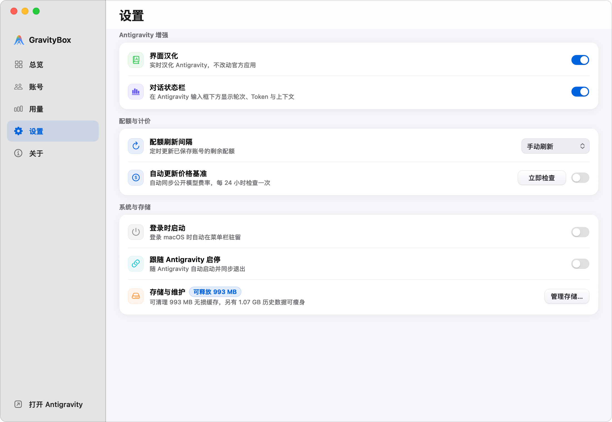
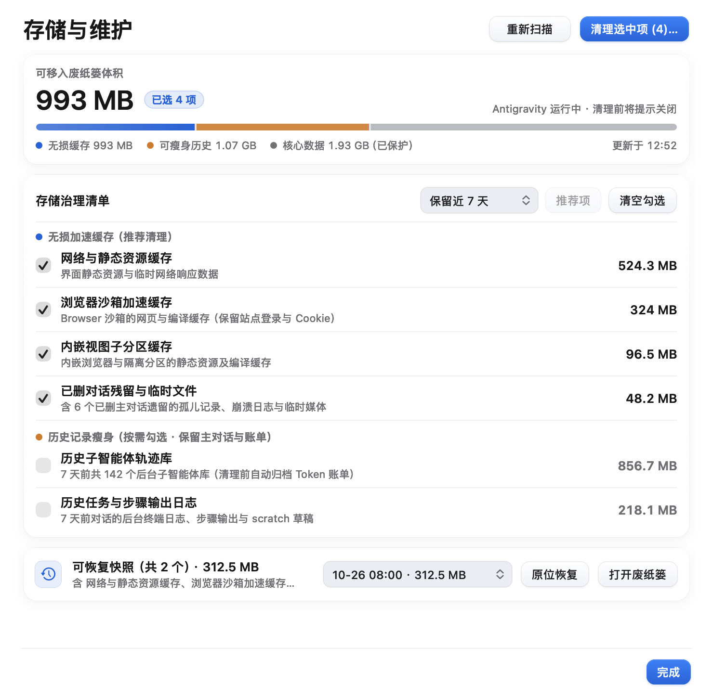
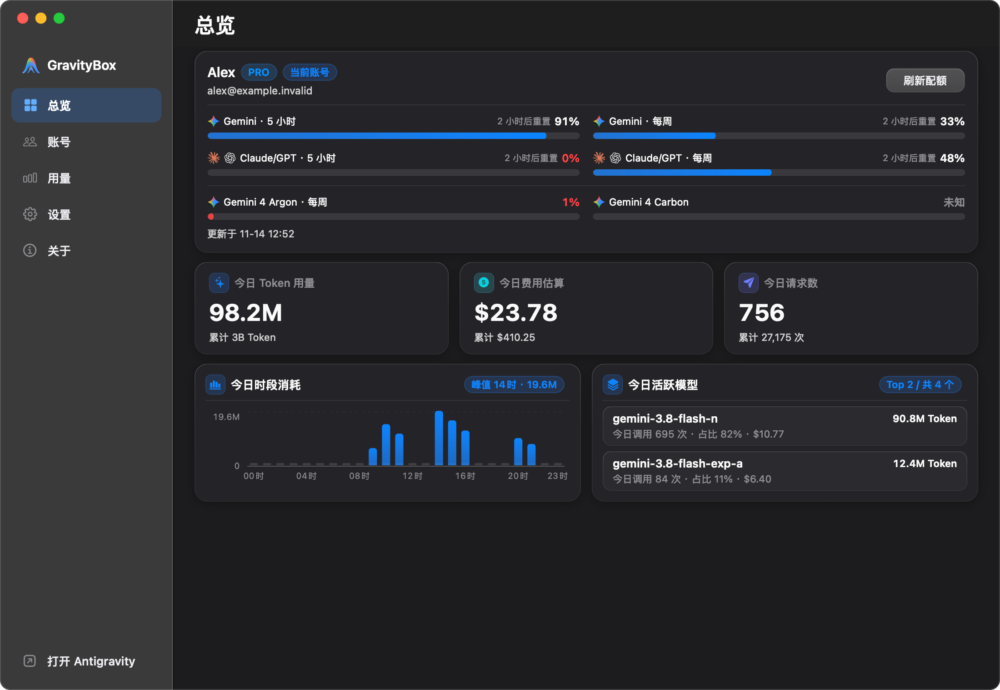
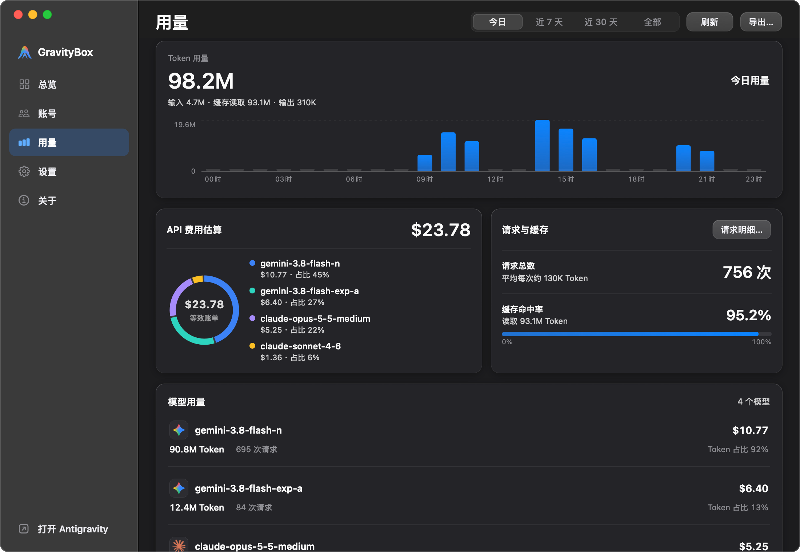
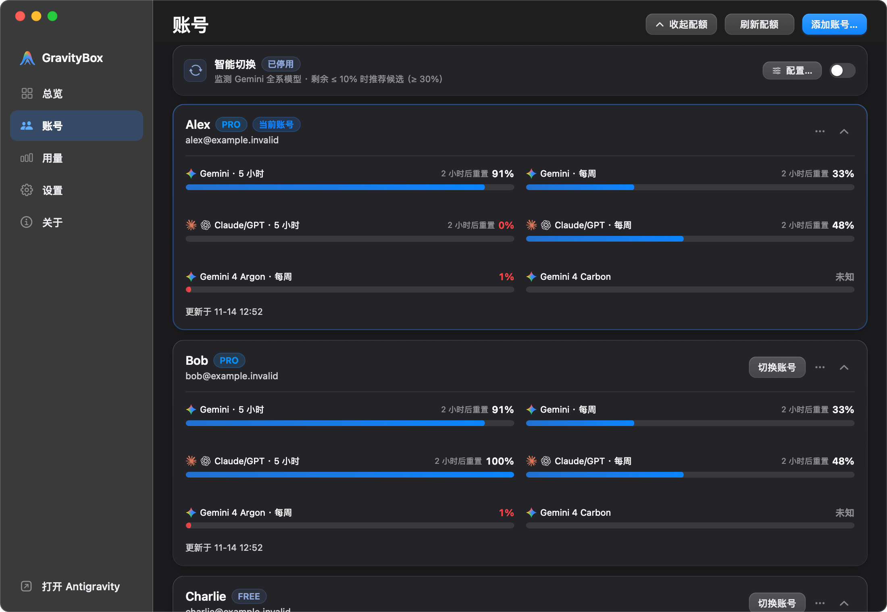
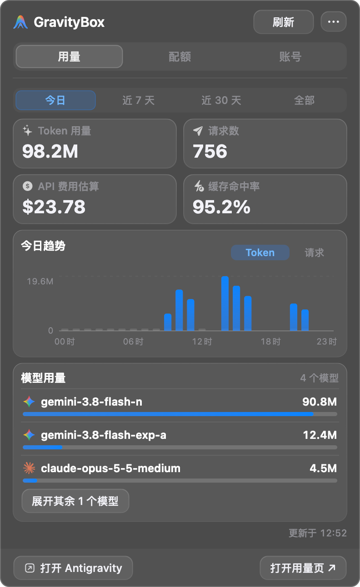
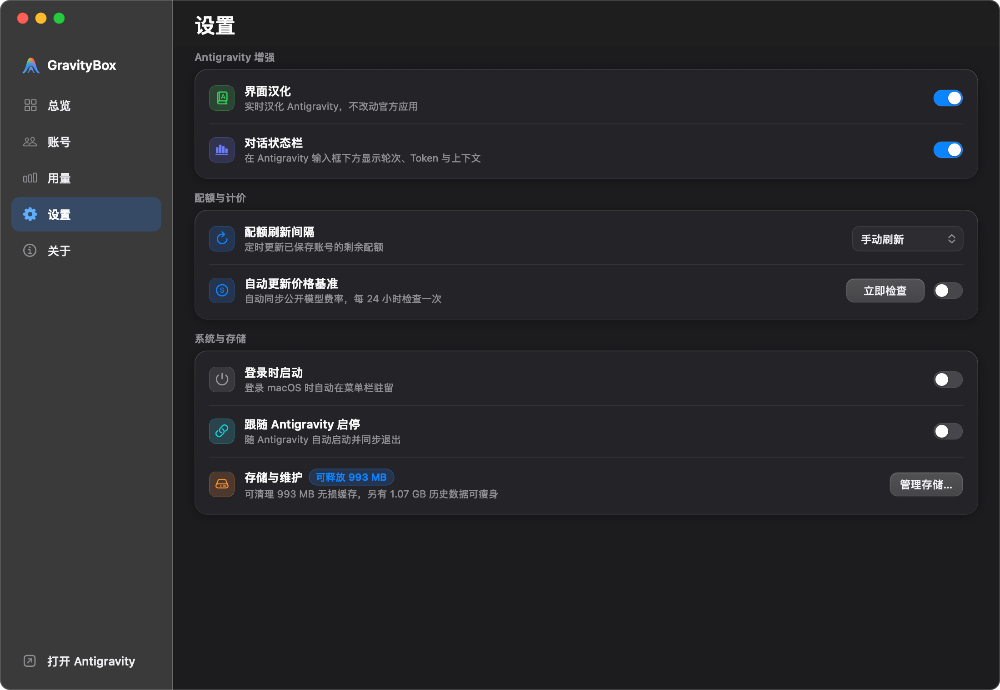
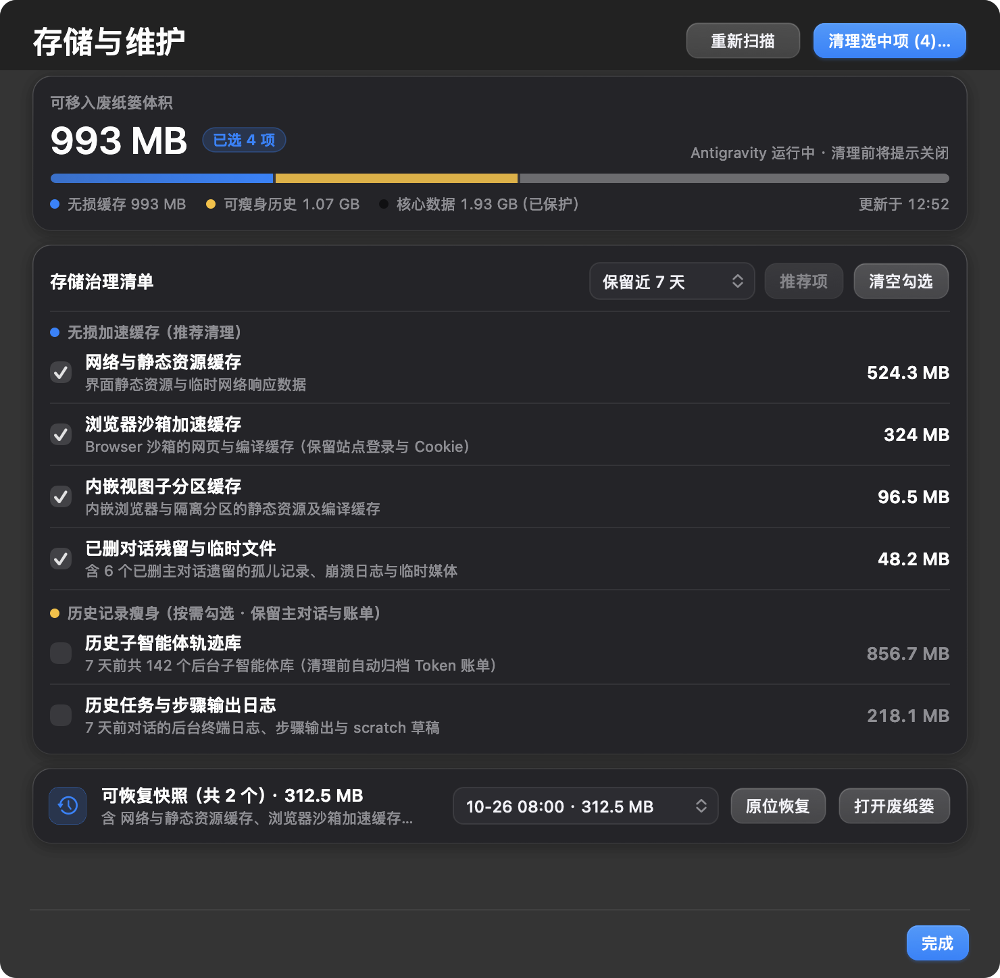
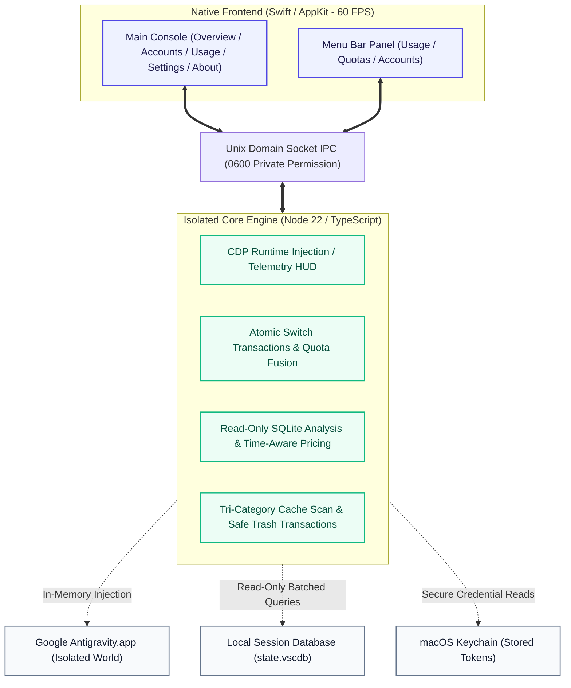

<div align="center">
  <a href="https://github.com/Enzoo404/gravitybox">
    
  </a>

  <h1>GravityBox</h1>

  <p>
    <strong>The Native macOS Productivity Suite for Google Antigravity</strong><br>
    <sub>Zero-Invasive UI Localization · In-IDE Telemetry HUD · Dual-Cycle Quota Radar · Atomic Multi-Account Switcher · Token & Time-Aware Pricing · Safe Cache Cleaner</sub>
  </p>

  <p>
    <strong>English</strong> · <a href="README.md">简体中文</a>
  </p>

  <p>
    <a href="https://github.com/Enzoo404/gravitybox/releases/latest"></a>
    <a href="https://github.com/Enzoo404/gravitybox/actions/workflows/ci.yml"></a>
    <a href="https://github.com/Enzoo404/gravitybox/releases"></a>
    <a href="./LICENSE"></a>
    
    
    
    <a href="https://github.com/Enzoo404/gravitybox/stargazers"></a>
  </p>

  <p>
    <a href="https://github.com/Enzoo404/gravitybox/releases/latest"><b>📥 Download for macOS (.dmg)</b></a> ·
    <a href="#-quick-start"><b>⚡ Quick Start</b></a> ·
    <a href="#-why-gravitybox"><b>💡 Why GravityBox?</b></a> ·
    <a href="#-core-features"><b>✨ Core Features</b></a> ·
    <a href="#-architecture--principles"><b>📐 Architecture</b></a> ·
    <a href="#-security--privacy"><b>🛡️ Security & Privacy</b></a>
  </p>
</div>

<p align="center">
  <picture>
    <source media="(prefers-color-scheme: dark)" srcset="assets/screenshots/hero-dark.png">
    <source media="(prefers-color-scheme: light)" srcset="assets/screenshots/hero.png">
    
  </picture>
</p>

<p align="center">
  <strong>Crafted natively for macOS: Monitor quotas, inspect conversation throughput, and audit token usage right beside your code.</strong>
</p>

---

## 💡 Why GravityBox?

| Consideration | Stock Google Antigravity | Community Scripts / Patchers | **GravityBox Native Suite** |
| :--- | :--- | :--- | :--- |
| **Localization & Display** | English only; non-English developers face cognitive load | Unpacks `app.asar`, invalidates code signature, breaks on updates | **Zero-invasive in-memory hot-patching**; never touches app binaries; survives updates seamlessly |
| **Conversation Telemetry** | Spinner only; impossible to gauge latency or model velocity | Not supported | **In-IDE tri-capsule HUD**: Live turn duration, TTFT (latency), actual TPS throughput & context waterline |
| **Quota Visibility** | Plain dropdown percentage; opaque rolling window | Raw packet scraping; conflates 5-hour and weekly caps | **Dual-cycle fusion radar**: Accurately separates 5-hour rolling & weekly caps with color-coded alerts |
| **Multi-Account Workflow** | Tedious manual sign-outs; frequent session conflicts | Forcible cookie replacement; prone to corrupted state | **4-phase atomic transaction** with 7-day automated snapshot and one-click rollback |
| **Usage & Cost Analytics** | No usage dashboard; opaque long-term consumption | Missing or rudimentary local counters | **Asynchronous read-only SQLite auditing** with time-aware historical pricing and cache-hit metrics |
| **Footprint & Security** | — | Unknown script privileges; risks config corruption | **100% local, zero telemetry**; sensitive files locked to `0600`; native Trash-based soft deletion |

---

## 📸 Gallery Showcase (Retina HD Gallery)

<p align="center">
  
  
</p>
<p align="center">
  
  
</p>
<p align="center">
  
  
</p>

<details>
<summary><strong>🌙 Click to view Dark Mode Showcase Gallery</strong></summary>

<br>

<p align="center">
  
  
</p>
<p align="center">
  
  
</p>
<p align="center">
  
  
</p>

</details>

<p align="center"><sub>All screenshots captured via native macOS 14+ AppKit at crisp 2x Retina resolution with sensitive identities fully redacted. <a href="assets/screenshots/README.md">View complete asset specs and privacy standards</a></sub></p>

---

## ✨ Core Features

### 1. 🌐 Zero-Invasive Runtime Localization
- **No binary tampering or ASAR repacking**: Delivers on-the-fly Chinese localization via local Chrome DevTools Protocol (CDP) debugging channel; macOS Gatekeeper signature remains 100% valid;
- **Strict AST & selector protection**: Automatically preserves code editors (`.monaco-editor`), terminal buffers (`.xterm`), conversation bodies, and code blocks—never alters user code or prompt text;
- **Instant toggle & clean fallback**: Switch localization on or off with millisecond responsiveness, reverting instantly to pristine stock English without restarting Antigravity.

### 2. ⚡️ In-IDE Conversation Telemetry HUD
- **Tri-capsule status bar embedded right into the chat input**: Glances performance directly below your prompt editor;
- **Essential real-time telemetry**:
  - **Turns & Latency**: Tracks turn numbers, agent tool execution steps, and **TTFT (Time-to-First-Token)**;
  - **Throughput Velocity**: Calculates true live **TPS (Tokens Per Second)** during streaming;
  - **Context Waterline**: Visualizes input, output, and cumulative prompt tokens as a percentage of the model's max context window, alerting you before truncation occurs;
- **Independent operation**: Can be enabled as an English HUD even when Chinese localization is turned off.

### 3. ⏱️ Dual-Cycle Quota Radar (5-Hour & Weekly)
- **Comprehensive tier support**: Accurately tracks PRO, ULTRA, and FREE subscription tiers across Gemini, Claude, and GPT model families;
- **Strict temporal separation**: Disentangles the dynamic 5-hour rolling window from weekly caps, providing reliable reset countdowns;
- **Tiered visual alerts**: Progress bars transition to warning orange at `≤20%` remaining, and critical red at `≤10%` or depletion.

### 4. 🔄 Atomic Multi-Account Management & Safe Switch
- **Zero-config onboarding**: Save current active credentials with one click, or add backup accounts via Google OAuth;
- **Safe atomic transaction**: Shuts down Antigravity gracefully before committing credential writes, preventing corrupted keychain states;
- **7-day rollback snapshot**: Automatically creates timestamped recovery points, allowing one-click rollback if any account anomaly occurs;
- **Smart recommendation**: Highlights the healthiest standby account when active quotas dip below thresholds.

### 5. 📊 Token-Level Usage Audit & Time-Aware Pricing
- **Multi-interval consumption dashboards**: View input, output, and cache read/write tokens across **Today**, **Last 7 Days**, **Last 30 Days**, or **All Time**;
- **Historical temporal billing**: Matches token consumption with historical pricing feeds ([`assets/model-catalog.json`](./assets/model-catalog.json)) active at the exact time of invocation;
- **Granular request logs**: Review historical requests sorted by timestamp with model metadata, latencies, and four-tier token distributions, exportable to JSON.

### 6. 🛡️ Safe Non-Destructive Cache Cleaner
- **Tri-category safe scan**: Clearly isolates runtime speed-up caches (safe to clean), session state (caution required), and core databases (read-only locked);
- **Guaranteed database protection**: Conversation databases (`state.vscdb`) and credential stores are strictly protected from accidental deletion;
- **System Trash soft deletion**: Selected files are safely moved to the macOS Trash, never hard-deleted, supporting instant restoration;
- **Automated verified updates**: Integrated update checker verifies SHA-256 digests, DMG images, and code signatures prior to installation.

---

### Dual-Surface Native Architecture

Constructed natively with Swift / AppKit for 60 FPS performance and seamless macOS Light / Dark mode transitions:

- **Menu Bar Quick Panel**: Resides permanently in the macOS menu bar with lightweight tabs for **Usage**, **Quotas**, and **Accounts**;
- **Main Console**: A full-featured desktop window with a frosted-glass sidebar providing deep analytical views (`⌘1` Overview, `⌘2` Accounts, `⌘3` Usage, `⌘4` Settings, `⌘5` About).

---

## ⚡ Quick Start

### System Requirements
- **Operating System**: macOS 14.0 (Sonoma) or macOS 15+ (Sequoia)
- **Hardware Architecture**: Apple Silicon (`arm64`, M1/M2/M3/M4 series chips)
- **Host Application**: Google Antigravity (Stable channel)
- **Self-Contained Runtime**: Bundled with a stand-alone Node 22 environment—**no external Node.js installation required**.

### 1. Download & Installation
1. Download the latest `GravityBox-<version>-arm64.dmg` from [**Releases**](https://github.com/Enzoo404/gravitybox/releases/latest);
2. Double-click the DMG and drag `GravityBox.app` into your `Applications` folder;
3. Since GravityBox uses local ad-hoc code signing, run this command in Terminal if Gatekeeper displays an untrusted developer warning:

   ```bash
   sudo xattr -rd com.apple.quarantine /Applications/GravityBox.app
   ```

### 2. Getting Started
1. **Enable Localization**: Launch GravityBox, toggle **"界面汉化 (UI Localization)"** in the main window or menu bar, and Antigravity will instantly render in Chinese;
2. **Onboard Active Account**: In the Accounts tab, click **"Add Account... -> Save Current Account"** to immediately monitor quotas;
3. **Experience the Telemetry HUD**: Start any conversation in Antigravity to see live latency and velocity metrics below the prompt input.

<details>
<summary><strong>⚙️ Optional Configuration: Google OAuth Credentials for Standby Refresh (Click to expand)</strong></summary>

<br>

> [!NOTE]
> Saving current local credentials, monitoring local quotas, localization, conversation HUD, and cache cleaning **do NOT require this configuration**.

If you wish to authenticate multiple standby accounts via browser OAuth or enable background cloud-based quota refreshes for inactive accounts, configure your own Google OAuth Client credentials.

Copy [`.env.example`](./.env.example) to `.env` inside `~/Library/Application Support/GravityBox/.env`:

```bash
# Google OAuth Client Credentials (for browser authentication and cloud quota refresh)
GRAVITYBOX_GOOGLE_CLIENT_ID=your_client_id.apps.googleusercontent.com
GRAVITYBOX_GOOGLE_CLIENT_SECRET=your_client_secret
```

</details>

---

## ❓ FAQ

<details>
<summary><strong>Q1: Does localization modify Antigravity files or break official updates?</strong></summary>

<br>

No. GravityBox communicates via a local loopback CDP channel to dynamically substitute interface strings in runtime memory. It never repacks `app.asar` or tampers with application binaries, keeping Gatekeeper signatures intact and surviving official Antigravity updates automatically.
</details>

<details>
<summary><strong>Q2: How does the Telemetry HUD work, and does it affect editor performance?</strong></summary>

<br>

The HUD uses lightweight DOM projection and debounced state listeners active only during prompt streaming. Memory overhead is negligible (<0.5% CPU), and all metrics are derived locally without generating extra outbound requests.
</details>

<details>
<summary><strong>Q3: Does the estimated API cost reflect my actual bill?</strong></summary>

<br>

No. It is an equivalent benchmark value calculated by multiplying local token metrics by public model API price cards. It helps developers quantify their daily usage scale and does not represent billing charges on subscription plans.
</details>

<details>
<summary><strong>Q4: Is Intel (x86_64) Mac supported?</strong></summary>

<br>

GravityBox is strictly optimized and compiled for Apple Silicon (`arm64`). Intel binaries are not currently provided.
</details>

---

## 📐 Architecture & Principles



---

## 🛡️ Security & Privacy

- **Zero Telemetry**: Completely devoid of analytics, telemetry beacons, or crash reporters. All calculations stay on your Mac;
- **Strict File Permissions**: Configurations and tokens are kept in `~/Library/Application Support/GravityBox` with `0600` user-only permissions;
- **Read-Only SQLite Analysis**: Session analysis employs read-only SQLite transactions, ensuring Antigravity database consistency is never compromised;
- **Transparent Network Boundaries**: Auto-update and pricing sync remain disabled by default; outbound calls only connect to official Google OAuth/quota endpoints on user action, or GitHub Releases and public pricing feeds (GitHub Raw with `cdn.jsdelivr.net` fallback) when explicitly enabled or triggered;
- **Open & Transparent**: Source code is fully open for community inspection, with release DMG binaries verified via automated SHA-256 sidecars.

---

## 🛠️ Building from Source

To build, debug, or package GravityBox locally, you will need **macOS 14+**, **Node.js `>=22.15.0 <23`**, and **Xcode Command Line Tools** (`swiftc`):

```bash
# 1. Clone repository and install dependencies
git clone https://github.com/Enzoo404/gravitybox.git
cd gravitybox
npm ci

# 2. Check toolchains and local environment
npm run doctor

# 3. Run compilation, pricing consistency checks, and unit/integration tests
npm test

# 4. Run full release gate (unit/integration, headless browser regression, Swift -O check, and dictionary gate)
npm run verify

# 5. Produce native macOS DMG release installer
npm run package:mac
```

Packaged installers and SHA-256 hashes will be placed in the `成品/` (Distributables) directory.

---

## 🌟 Community & Contributing

Contributions and feedback are warmly welcomed! Please submit an [Issue](https://github.com/Enzoo404/gravitybox/issues) or open a Pull Request.
Before submitting code, please review our [Contributing Guide (CONTRIBUTING.md)](./CONTRIBUTING.md) and [Code of Conduct (CODE_OF_CONDUCT.md)](./CODE_OF_CONDUCT.md).

<p align="center">
  <a href="https://star-history.com/#Enzoo404/gravitybox&Date">
    
  </a>
</p>

---

## 📄 Disclaimer & License

GravityBox is an independent open-source project and is not affiliated with, sponsored by, or endorsed by Google LLC, Anthropic PBC, OpenAI Inc., or Apple Inc. All brand names and trademarks belong to their respective holders.

Licensed under the [MIT License](./LICENSE) · Copyright © 2026 [Enzoo404](https://github.com/Enzoo404)
