<div align="center">
  <a href="https://github.com/Enzoo404/gravitybox">
    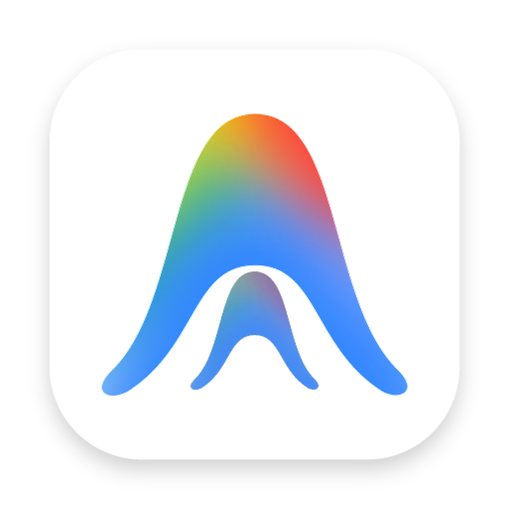
  </a>

  <h1>GravityBox</h1>

  <p>
    <strong>Lightweight Native macOS Companion for Antigravity on Apple Silicon</strong><br />
    Native Swift AppKit UI · In-IDE Telemetry HUD · Dual-Window Quota Monitor · Read-Only SQLite Usage &amp; Cost Engine · Non-Invasive Runtime Localization
  </p>

  <p>
    <a href="https://github.com/Enzoo404/gravitybox/releases/latest"></a>
    <a href="https://github.com/Enzoo404/gravitybox/actions/workflows/ci.yml"></a>
    
    <a href="./LICENSE"></a>
  </p>

  <p>
    <a href="./README.md">简体中文</a> · <b>English</b>
  </p>

  <p>
    <a href="#-why-gravitybox">Why GravityBox</a> ·
    <a href="#-in-ide-telemetry-hud">Telemetry HUD</a> ·
    <a href="#-key-capabilities">Capabilities</a> ·
    <a href="#-screenshots">Screenshots</a> ·
    <a href="#-installation--upgrades">Installation</a> ·
    <a href="#-architecture--building-from-source">Architecture &amp; Build</a> ·
    <a href="#-security--privacy-boundaries">Security</a>
  </p>
</div>

<br />

<div align="center">
  <picture>
    <source media="(prefers-color-scheme: dark)" srcset="assets/screenshots/hero-dark.png" />
    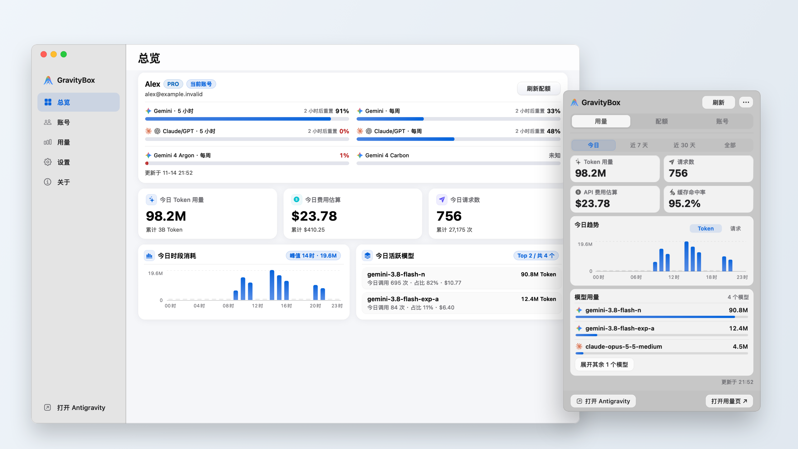
  </picture>
  <sub><em>Native macOS AppKit Console &amp; Menu Bar Panel (automatically adapts to macOS Light / Dark appearance)</em></sub>
</div>

---

## ✨ Why GravityBox?

GravityBox complements `/Applications/Antigravity.app` without altering official binaries or signatures—bringing multi-account safety, dual-cycle quota clarity, and local token accounting together in a native macOS experience:

| Area | Default Experience | GravityBox Approach |
| :--- | :--- | :--- |
| **Account Switching** | Manual sign-out/sign-in with risk of stale state or accidental overwrites | **4-phase atomic snapshot transaction + automatic rollback**; validates no shared-credential conflict before user-confirmed switches |
| **Quota Window Clarity** | Weekly allowances are easily mistaken for 5-hour rolling windows | **Strict Dual-Window Separation**; prioritizes true 5-hour windows and clearly labels reset times when missing |
| **Live Session & Cost Visibility** | No real-time view into per-turn speed, TTFT, cache savings, or context composition | **In-IDE Telemetry HUD** + **Read-Only SQLite Accounting** using dated pricing-feed windows |
| **Localization Integrity** | Static binary patches break app code signatures across every update | **CDP Runtime Injection** with DOM-protected boundaries—never unpacks or re-signs `/Applications/Antigravity.app` |
| **Cache & Storage Cleanup** | Session logs accumulate over time with risk of irreversible manual deletion | Guided storage trim where all deletions **move safely to macOS Trash** with timestamped snapshots for one-click restore |

---

## 📊 In-IDE Telemetry HUD

Mounted cleanly beneath every Antigravity conversation composer—without overlapping input controls or stealing editor focus—the tri-capsule HUD expands upward on click or hover across multi-pane layouts and light/dark themes:

<div align="center">
  <picture>
    <source media="(prefers-color-scheme: dark)" srcset="assets/screenshots/hud-dark.png" />
    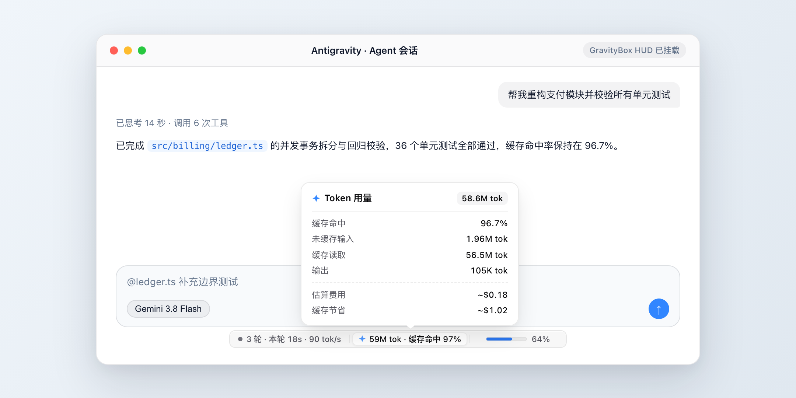
  </picture>
</div>

- **Session & Throughput Capsule**: Tracks turns, model vs. tool execution duration, and Time-To-First-Token (TTFT, excluding thinking idle gaps for accurate `tok/s`), with subtle streaming and subagent activity indicators.
- **Tokens & Cost Capsule**: Breaks down total, uncached input, cached read, and output tokens alongside cache hit rate, estimated API cost, and cache cost savings.
- **Context Window Capsule**: Renders a three-segment breakdown bar (System Prompt · Tool Definitions · Conversation Messages) calibrated against each model's true context limit.

---

## 🧭 Key Capabilities

### 1. Multi-Account Management & 4-Phase Safe Switching
- **Candidate Recommendations (User-Confirmed)**: Scores saved standby accounts by remaining quota, disabled flags, and freshness to surface recommendations while leaving switch execution under explicit user confirmation.
- **No Force-Killing**: Never kills Antigravity in the background; verifies that the official app (and any credential-sharing Insiders instance) is closed before touching account state.
- **Automatic In-Place Rollback**: Any error during backup, sync, or post-switch verification immediately restores the pre-switch snapshot.

### 2. Dual-Window Quota Monitor & Local Cost Engine
- **Accurate Window Semantics**: Separates Gemini 5-hour rolling windows, weekly quotas, and Claude/GPT pools while preserving exact `Unknown`, `Disabled`, `Exhausted`, and `Stale` states.
- **Non-Blocking SQLite Projection**: Scans local session state in batched read-only SQLite worker transactions with `Today`, `7 Days`, `30 Days`, and `All Time` charts plus hourly usage trends.
- **Time-Boxed Pricing Feed**: Revalues historical consumption against dated model pricing intervals with optional GitHub release checks for pricing feed updates.

### 3. Non-Invasive Bilingual Adaptation (`中文 / En`)
- **Zero App Modification**: Injects isolated runtime localization over Chrome DevTools Protocol (`CDP`), adapting new Antigravity updates cleanly without modifying `/Applications/Antigravity.app`.
- **Protected User Content**: Unsent drafts, chat history, code blocks, terminal output, workspace names, and brand terms are isolated behind DOM selectors.
- **Graceful Fallback**: Automatically retains valid mappings or falls back cleanly to official English if DOM structure changes unexpectedly.

### 4. Reversible Maintenance & Menu Bar Companion
- **Trash-First Cleanup**: Previews reclaimable cache and snapshot sizes before moving selected artifacts to the macOS Trash alongside one-click snapshot restoration.
- **Menu Bar Efficiency**: Supports Launch at Login and synchronized launch/exit with Antigravity, providing instant access to `Usage · Quota · Accounts`.

---

## 🖼 Screenshots

> Built natively with Swift AppKit for macOS. Every preview below automatically adapts to your browser or OS Light / Dark theme.

<table>
  <tr>
    <td width="50%" align="center">
      <b>Main Console · Overview</b><br /><br />
      <picture>
        <source media="(prefers-color-scheme: dark)" srcset="assets/screenshots/dark-overview.png" />
        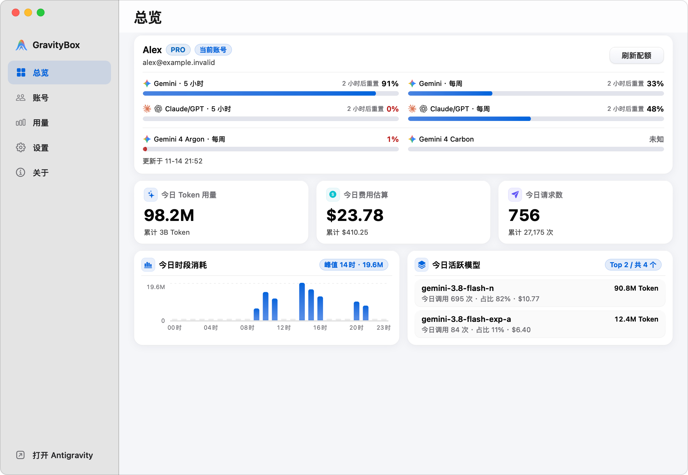
      </picture>
    </td>
    <td width="50%" align="center">
      <b>Main Console · Accounts</b><br /><br />
      <picture>
        <source media="(prefers-color-scheme: dark)" srcset="assets/screenshots/dark-accounts.png" />
        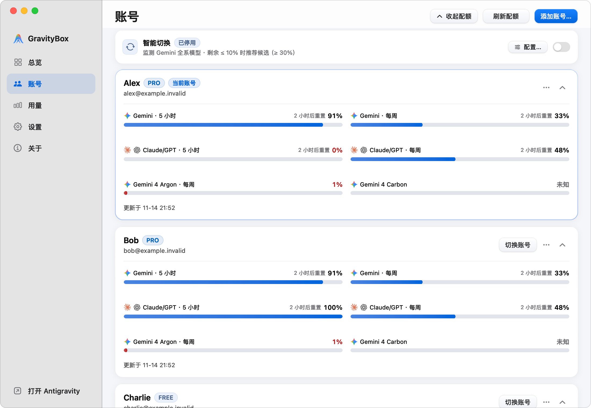
      </picture>
    </td>
  </tr>
  <tr>
    <td width="50%" align="center">
      <b>Main Console · Usage &amp; Cost</b><br /><br />
      <picture>
        <source media="(prefers-color-scheme: dark)" srcset="assets/screenshots/dark-usage.png" />
        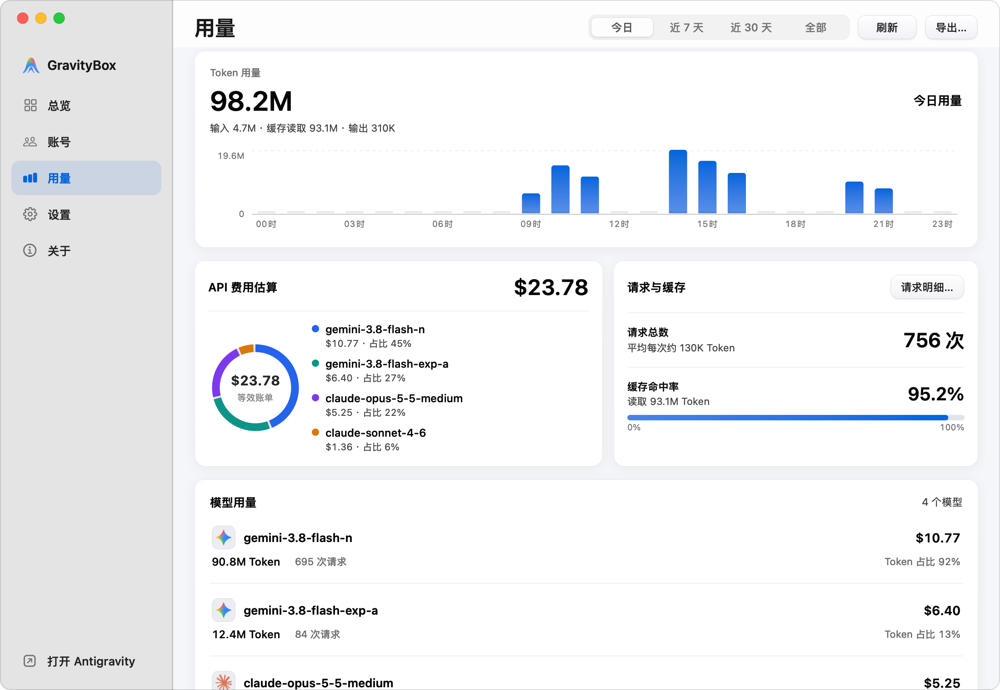
      </picture>
    </td>
    <td width="50%" align="center">
      <b>Main Console · Settings</b><br /><br />
      <picture>
        <source media="(prefers-color-scheme: dark)" srcset="assets/screenshots/dark-settings.png" />
        
      </picture>
    </td>
  </tr>
</table>

<details>
<summary>Show more screenshots: Menu Bar Panel tabs, Storage Maintenance sheet, and About view</summary>
<br />
<table>
  <tr>
    <td width="33.3%" align="center">
      <b>Menu Bar · Usage</b><br /><br />
      <picture>
        <source media="(prefers-color-scheme: dark)" srcset="assets/screenshots/dark-menubar.png" />
        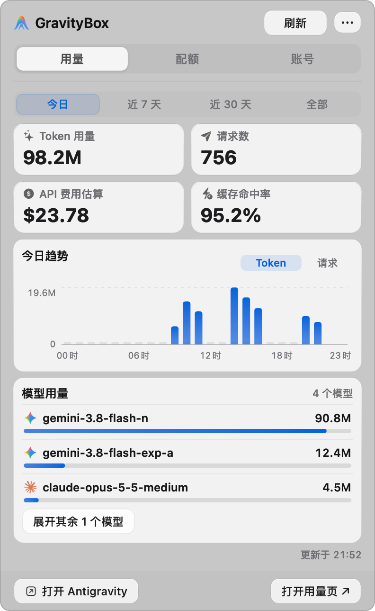
      </picture>
    </td>
    <td width="33.3%" align="center">
      <b>Menu Bar · Quota</b><br /><br />
      <picture>
        <source media="(prefers-color-scheme: dark)" srcset="assets/screenshots/dark-menubar-quota.png" />
        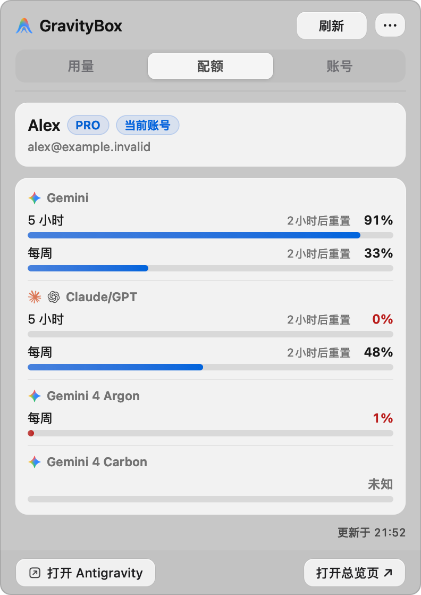
      </picture>
    </td>
    <td width="33.3%" align="center">
      <b>Menu Bar · Accounts</b><br /><br />
      <picture>
        <source media="(prefers-color-scheme: dark)" srcset="assets/screenshots/dark-menubar-accounts.png" />
        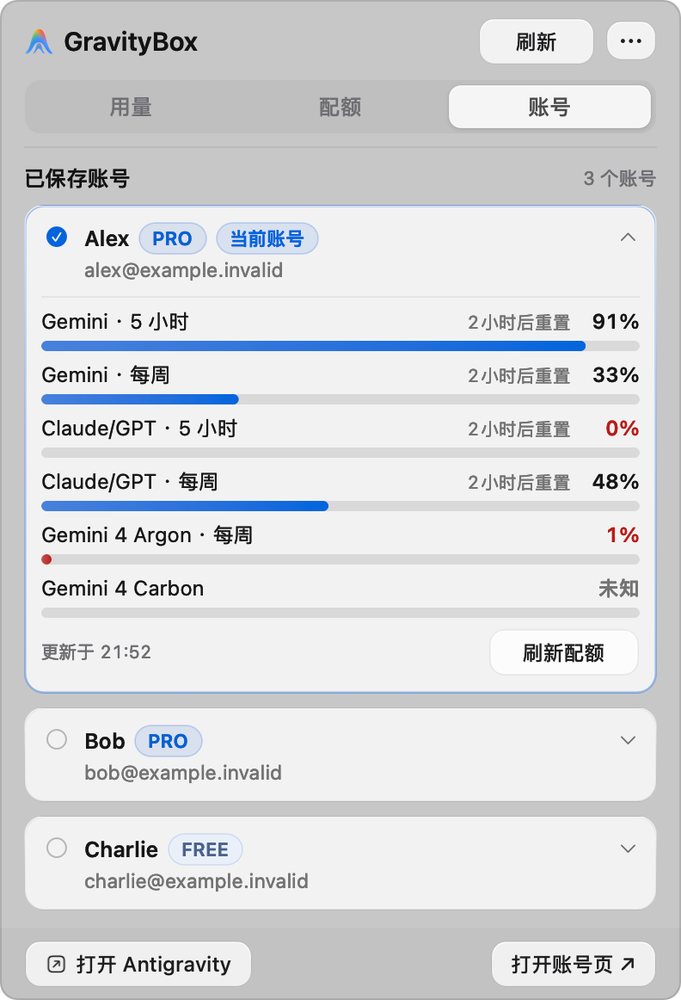
      </picture>
    </td>
  </tr>
  <tr>
    <td colspan="2" align="center">
      <b>Storage Trim &amp; Snapshot Restore</b><br /><br />
      <picture>
        <source media="(prefers-color-scheme: dark)" srcset="assets/screenshots/dark-maintenance.png" />
        
      </picture>
    </td>
    <td align="center">
      <b>About &amp; Updates</b><br /><br />
      <picture>
        <source media="(prefers-color-scheme: dark)" srcset="assets/screenshots/dark-about.png" />
        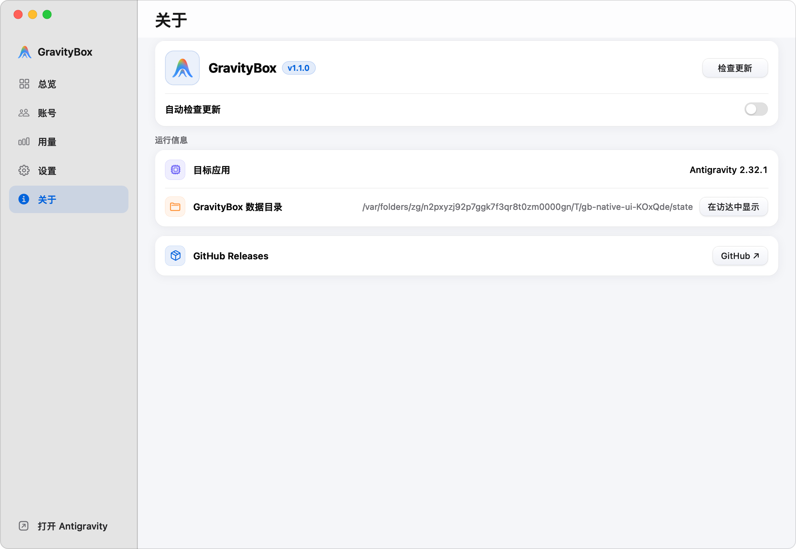
      </picture>
    </td>
  </tr>
</table>
</details>

---

## 🚀 Installation & Upgrades

### System Requirements
- **OS**: macOS 14 (Sonoma) or macOS 15+ (Sequoia)
- **Architecture**: Apple Silicon (`arm64`)
- **Target App**: Official release `/Applications/Antigravity.app` (*Insiders channel is neither supported nor modified*)
- **Runtime**: Self-contained Node 22 binary embedded inside the app bundle—zero prerequisites required

### First-Time Installation

1. Download the latest `GravityBox-<version>-arm64.dmg` and `.sha256` checksum from [GitHub Releases](https://github.com/Enzoo404/gravitybox/releases/latest).
2. *(Recommended)* Verify DMG integrity:
   ```bash
   shasum -a 256 -c GravityBox-<version>-arm64.dmg.sha256
   ```
3. Mount the DMG and drag **GravityBox.app** into **Applications**.
4. Because open-source builds are not Apple-notarized, clear Gatekeeper quarantine once before launching:
   - **Terminal (Recommended)**:
     ```bash
     xattr -cr /Applications/GravityBox.app
     ```
   - **System Settings**: If blocked on first launch, open **System Settings → Privacy & Security** and click **Open Anyway**.

### Non-Destructive Upgrades
- **Drop-In Replacement**: Quit GravityBox and drag the new app bundle over `/Applications/GravityBox.app`. All saved accounts, custom dictionary overrides, usage ledgers, and recovery snapshots under `~/Library/Application Support/GravityBox` are preserved intact.
- **Legacy Channel Migration**: Configurations from `v1.0.5` or earlier with `applicationChannel=insiders` are automatically backed up and migrated to official `stable` mode on first launch.
- **In-App Updates**: Background update checks remain off by default; check manually or opt in anytime from the **About** tab.

<details>
<summary>Optional: Custom Google OAuth credentials for source builds</summary>

Local quota inspection, the Telemetry HUD, SQLite cost tracking, and runtime localization require **no OAuth setup**. For source builds using live quota API refreshes, provide your own OAuth client credentials via environment variables:

```bash
export GRAVITYBOX_GOOGLE_CLIENT_ID="your-client-id.apps.googleusercontent.com"
export GRAVITYBOX_GOOGLE_CLIENT_SECRET="your-client-secret"
```

</details>

---

## 🔒 Security & Privacy Boundaries

| Principle | Implementation |
| :--- | :--- |
| **Zero Telemetry** | No analytics SDKs, crash telemetry, or unprompted outbound requests; update polling is off by default |
| **Untouched Official Binary** | Never patches, unpacks, or re-signs `/Applications/Antigravity.app` |
| **Local-Only State** | Accounts, keychain references, ledgers, and snapshots live exclusively in `~/Library/Application Support/GravityBox` |
| **Protected User Content** | Input drafts, messages, code blocks, terminal logs, and project names are excluded from DOM mutation |

---

## 🛠 Architecture & Building from Source

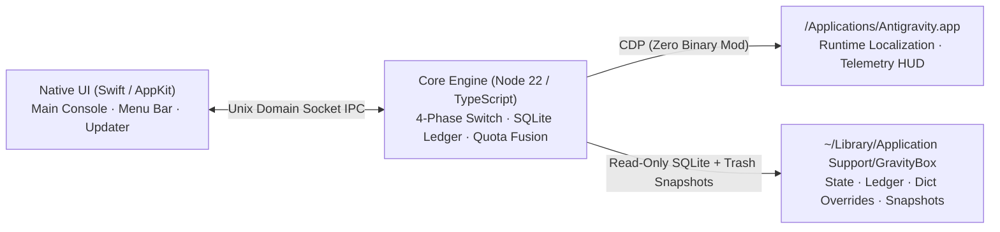

### Build & Verification Commands

> Requires Xcode Command Line Tools and Node.js `>=22.15.0 <23`.

```bash
git clone https://github.com/Enzoo404/gravitybox.git
cd gravitybox
npm ci

# TypeScript build, pricing sync check, and unit/integration tests
npm test

# Swift native UI compilation and layout verification
npm run check:swift

# Full release verification gate (TS + tests + headless browser + Swift + dict checks)
npm run verify

# Package local Apple Silicon .app and distributable .dmg
npm run package:mac
```

<details>
<summary>Repository layout</summary>

```text
gravitybox/
├── native/          # Swift 6 / AppKit Main Console, Menu Bar Panel, and native App Updater
├── src/             # TypeScript core engine (IPC, 4-phase switching, quota fusion, SQLite ledger, HUD state)
├── runtime/         # CDP-injected runtime scripts (localization engine, DOM guards, Telemetry HUD UI)
├── dict/            # Versioned bilingual dictionaries, frozen maps, and shared glossary rules
├── assets/          # App icons, Retina screenshots, dated pricing feed (pricing-feed.json), and model catalog
├── test/            # Unit, integration, headless Chromium regression, and Swift native UI suites
└── tools/           # Release integrity checks, Retina screenshot generator, and macOS DMG packager
```

</details>

---

## ❓ FAQ

<details>
<summary><b>Why must Antigravity be closed before switching accounts?</b></summary>

Overwriting account databases or keychain caches while the host IDE holds active file locks can corrupt SQLite state or authentication sessions. GravityBox checks running processes (never killing them silently) and executes a 4-phase atomic snapshot switch with automatic rollback.

</details>

<details>
<summary><b>Do localization or HUD features alter my code, chats, or workspace files?</b></summary>

No. All adjustments happen purely in the presentation layer with strict selector guards around editors, code blocks, chat content, terminal output, and workspace names. Disk project files remain completely untouched.

</details>

<details>
<summary><b>How do I uninstall or revert changes?</b></summary>

Use **Settings → Manage Storage** to restore any trimmed cache from its snapshot, or quit GravityBox, move `/Applications/GravityBox.app` to the Trash, and optionally remove `~/Library/Application Support/GravityBox`.

</details>

---

## 🤝 Contributing & License

- Read [CONTRIBUTING.md](./CONTRIBUTING.md), [CODE_OF_CONDUCT.md](./CODE_OF_CONDUCT.md), and [SECURITY.md](./SECURITY.md) before opening an [Issue](https://github.com/Enzoo404/gravitybox/issues) or Pull Request.
- Release notes and full version history are tracked in [CHANGELOG.md](./CHANGELOG.md) and [GitHub Releases](https://github.com/Enzoo404/gravitybox/releases).

<div align="center">
  <a href="https://star-history.com/#Enzoo404/gravitybox&Date">
    
  </a>
</div>

<p align="center">
  <sub>Licensed under the <a href="./LICENSE">MIT License</a> · Third-party attributions in <a href="./THIRD_PARTY_NOTICES.md">THIRD_PARTY_NOTICES.md</a> · Not affiliated with or endorsed by Google or Antigravity.</sub>
</p>
